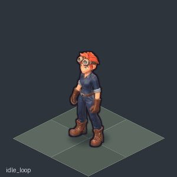
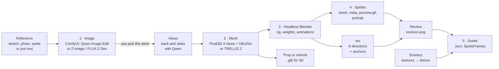
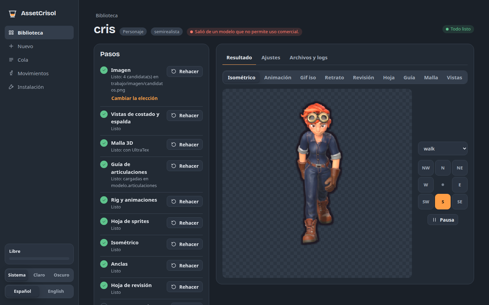

<div align="center">

# AssetCrisol

**From one image to 2D and 3D game assets, with local, open-source AI.**

Animated characters · props · vehicles · scenery kits → sprites, `.glb` files and Godot scenes

[](LICENSE)
[](#requirements)
[](#requirements)
[](#godot-guide)
[](#4-blender)



*Cris, the project's main character: isometric sprites generated end to end with AssetCrisol.*

[Español](README.md) · [Roadmap](ROADMAP.md) · [Start here](#start-here) · [For AI agents](#for-ai-agents) · [Contributing](CONTRIBUTING.md) · [Changelog](CHANGELOG.md)

</div>

> [!WARNING]
> **Work in progress.** The code works, but docs, examples and installation are still being tidied up for the first
> public release (v0.1 coming). Configurations may break between versions. What is done and what is next:
> [ROADMAP.md](ROADMAP.md) (Spanish).

> [!NOTE]
> **About names.** The code, the CLI and the config are in Spanish, so step names, keys and files stay in Spanish in
> this document too: `crisol malla` (mesh), `personaje.json` (character), `imagen.elegida` (chosen image),
> `trabajo/` (work folder), `objetos/` (props), `escenarios/` (scenery)... The meaning is explained the first time
> each one shows up.

Everything runs on your own machine: no paid APIs, no cloud services. *Crisol* is Spanish for *crucible*, the vessel
where material is melted down to give it shape: an image goes in, sprites, models and scenes come out.

> [!CAUTION]
> The code is **GPL-3.0**, but the AI models have their own licenses and **some are non-commercial**: UltraTex
> (FLUX.2 Klein 9B), used by the default humanoid recipe, and FLUX.2 Dev if you pick it for images without a
> reference (the default there is Z-Image Turbo, Apache-2.0). Read
> [Third-party licenses](#third-party-licenses) before using the output in a game you plan to sell.

---

## What you can make

| | Asset | From one image you get... | Key steps |
|---|---|---|---|
| 🧍 | **Animated character** | rig + 15 animations (walk, run, jump, punch, kick, die...) as a side-view sprite sheet, **isometric sheets in 8 directions**, a portrait and a front view for a selection screen, per-frame anchors to attach gear | `imagen` → `malla` → `blender` → `sprites` → `iso` |
| 📦 | **Prop** | crates, tables, chests, barrels: side view + isometric views with a contact shadow, `StaticBody2D` scenes with collision, or the `.glb` for a 3D game | `imagen` → `malla` → `blender` → `sprites` |
| 🚗 | **Vehicle** | `.glb` with the 4 wheels split into their own nodes (origin on the axle), a body with `pintura` (paint) / `oscuro` (dark) materials and a card image for a selection screen | `imagen` → `vistas` → `malla` → `blender` |
| 🌲 | **Scenery kit** | tileable floor, path and wall textures (normalized detail, tinted with the theme colors), a painted backdrop and `tema.json` with the colors | `texturas` → `tema` |

## How it works



Steps 1 and 2 use the GPU (minutes); from Blender onwards it takes seconds. Each step reads the asset's json and
writes into its `trabajo/` folder, so **any step can be re-run on its own**. Decisions (which image, which mesh, which
texture) are always made by a person looking at a candidates sheet.

---

## Start here

### Requirements

| | |
|---|---|
| OS | **Linux** (tested on Linux Mint 22.3, based on Ubuntu 24.04). Windows and macOS are untested. |
| GPU | **NVIDIA with 16 GB of VRAM** (tested on an RTX 4080 Super, driver 580) + CUDA 12.x toolkit |
| RAM | tested with 64 GB; 32 GB should be enough |
| Disk | ~90 GB (minimum level) or ~135 GB (full) for tools and models, + ~0.5-1 GB per character |
| Software | `python3` with Pillow, **Blender 5.1**, ComfyUI with `comfy-cli`, TRELLIS.2; optional: Kimodo, **Godot 4** and `uv` (for `crisol mcp`) |

<details>
<summary><b>Detailed requirements</b></summary>

| | |
|---|---|
| GPU | With less than 16 GB the mesh step does not fit; TRELLIS.2 officially asks for 24 GB and fits in 16 with `low_vram`. The CUDA **12.x** toolkit (not 13) is needed to build TRELLIS.2's extensions. RTX 50 cards (Blackwell) are untested: TRELLIS.2's torch 2.6 does not support them. With a driver older than 580, `instalar.sh` uses the CUDA 12.6 torch for ComfyUI. |
| RAM | Kimodo uses ~16 GB on CPU. |
| Disk | See *Disk per level* below. Tools and model caches should go to a disk with room (`instalar.sh --destino`, `env_modelos` in the config). |
| Python | system `python3` with **Pillow** (for `pipeline.py`). Each tool brings its own environment. |
| Blender | **5.1** (headless; the pipeline never touches an open Blender). |
| ComfyUI | recent (with the native Pixal3D, TRELLIS.2 and BiRefNet nodes) and the `comfy` CLI (`comfy-cli`) in its venv. |
| TRELLIS.2 | Microsoft's repo with its own venv (Python 3.10). |
| Kimodo | **optional**: only to generate new motion clips (the bundled ones are read without Kimodo). |
| Godot | **optional**: 4.x, only for `godot --instalar` (headless import). |

**Disk per level** (what `instalar.sh` downloads and installs):

| | GB | what |
|---|---|---|
| Environments | ~16 | ComfyUI (~8.5) and TRELLIS.2 (~6.6) venvs, Blender (1.3) |
| Minimum | ~69 | Qwen Image Edit + LoRA (31), Z-Image Turbo (21), TRELLIS.2 weights with DINOv3 (17) |
| Full | +~46 | Pixal3D with MoGe and BiRefNet (15), FLUX.2 Klein for UltraTex (19), DreamShaper XL + IP-Adapter (10), DWPose and rembg (~2) |
| `--flux2` | +42 | FLUX.2 Dev Q5 + its text encoder |
| `--kimodo` | +~19 | Kimodo: its venv, the text encoder (Llama 3 8B) and the model |

Total: **~90 GB** minimum, **~135 GB** full. Installing leaves ~15 GB of packages in `<destino>/.uv-cache` (not on the
system disk): remove them with `UV_CACHE_DIR=<destino>/.uv-cache uv cache clean`.
Each character with a mesh takes ~0.5-1 GB in `datos_dir`.

**Timings** on the reference board (RTX 4080 Super 16 GB, 64 GB of RAM):

| step | time |
|---|---|
| `instalar.sh` | however long ~135 GB take to download (at 50 MB/s, ≈45 min) + ~10 min to compile TRELLIS.2 |
| `imagen` | ≈20 s per seed (Qwen Image Edit or Z-Image Turbo); FLUX.2 Dev ≈3.5 min |
| `vistas` | ≈1 min (back and sides with Qwen) |
| `malla` | Pixal3D ≈2 min (1 view) or ≈3 min (4 views); TRELLIS.2 ≈3 min; + UltraTex ≈1-6 min. Props with their 3 candidates: ≈10-15 min (the `pixal3d` one at 1536 takes 1-8 min depending on volume: a solid barrel ≈7) |
| `blender` | ≈1 min (rig, weights, all animations) |
| `iso` / `anclas` | ≈25 s / ≈3 s |
| `texturas` | ≈5 s per image (DreamShaper), ≈15 s (Z-Image) |
| `movimiento` (Kimodo) | ≈2.5 min on CPU |

</details>

### Automatic install (recommended)

With Docker: see [docs/docker.en.md](docs/docker.en.md) (public image `ghcr.io/facundoalmon/assetcrisol`, with everything but the models). Without Docker:

```bash
git clone https://github.com/facundoAlmon/AssetCrisol.git && cd AssetCrisol
./instalar.sh --plan                    # what it will do, without doing anything
./instalar.sh                           # full level in ~/assetcrisol-herramientas (or --destino /big/disk)
mkdir -p ~/.local/bin && ln -s "$PWD/crisol" ~/.local/bin/crisol   # the `crisol` command (or ./crisol from here)
```

`instalar.sh` installs ComfyUI (with its node packs), TRELLIS.2 (it compiles its extensions for your GPU) and
Blender 5.1 at pinned commits, downloads the models and fills in `config.json`. It finishes by running
`crisol doctor`. It never uses `sudo`: if something system-wide is missing (NVIDIA driver, **CUDA 12.x toolkit** to
compile TRELLIS.2, `git`, Pillow), it tells you how to install it. It can be re-run: whatever is already there is
skipped, and a failed step resumes from where it stopped.

| option | |
|---|---|
| `--nivel minimo` | Qwen Image Edit + Z-Image Turbo + TRELLIS.2 + Blender (~90 GB): image, mesh, animation, sprites, Godot |
| `--nivel completo` | default: + Pixal3D, UltraTex, DWPose and scenery (~135 GB) |
| `--flux2` | + FLUX.2 Dev and ComfyUI-GGUF (~42 GB, non-commercial license) |
| `--kimodo` | + Kimodo, for new motion clips (~19 GB; runs on CPU) |
| `--destino DIR` | where the tools and the model cache go (pick a disk with room) |
| `--solo comfyui,modelos,trellis,blender,kimodo,config` | only those components |

**Gated** models (accept the terms on their Hugging Face page with your account): DINOv3
(`facebook/dinov3-vitl16-pretrain-lvd1689m`, for TRELLIS.2) and, at the full level, FLUX.2 Klein
(`black-forest-labs/FLUX.2-klein-base-9b-fp8`, for UltraTex). The script asks for a read token and tells you if a
license still needs to be accepted.

If `config.json` already points to an installed ComfyUI or TRELLIS.2, they are used as they are (their code and venv
are not touched): only missing node packs and models are added (same with Kimodo). Godot (optional) is installed
by hand.

### Manual install

```bash
# 1. Clone and configure
git clone https://github.com/facundoAlmon/AssetCrisol.git && cd AssetCrisol
cp config.ejemplo.json config.json      # and fill in the paths
python3 -c "import PIL"                 # pipeline.py needs Pillow (apt install python3-pil)
mkdir -p ~/.local/bin && ln -s "$PWD/crisol" ~/.local/bin/crisol   # the `crisol` command (or ./crisol from here)
```

2. **ComfyUI** with its venv, `comfy-cli`, 4 extra node packs and the models → [ComfyUI](#2-comfyui-image-pixal3d-ultratex-dwpose-scenery)
3. **TRELLIS.2** with its venv (Python 3.10, `transformers==4.57.1`) → [TRELLIS.2](#3-trellis2-alternative-engine-its-venv-also-runs-rembg)
4. **Blender 5.1** → [Blender](#4-blender)
5. *(optional)* **Kimodo** for new motion clips → [Kimodo](#5-kimodo-optional)

Then: `crisol doctor` checks the installation (config, paths, venvs, nodes, models, GPU) and tells you what is
missing, how to fix it and which steps are disabled. `crisol --help` lists the steps.

<details>
<summary><b>1. config.json</b></summary>

`config.json` (not versioned) holds:

| key | what it is |
|---|---|
| `datos_dir` | where `personajes/` (characters), `objetos/` (props), `escenarios/` (scenery) and `movimientos/candidatos/` (motion candidates) are created; relative to the config file. Defaults to `.` (the repo folder, ignored by git). Better point it to a folder of your own outside the repo. |
| `estilo` | default style (`estilos/<name>.json`; the example uses `moderno`), see [Styles](#styles) |
| `comfyui_dir`, `comfyui_url` | ComfyUI folder (with `venv/bin/python` and `venv/bin/comfy`) and its URL |
| `trellis2_dir` | TRELLIS.2 folder (with `venv/bin/python`) |
| `kimodo_dir` | Kimodo folder (with `venv/bin/python`); only for `crisol movimiento` |
| `env_modelos` | environment variables for the model caches (`HF_HOME`, `U2NET_HOME`...) |
| `blender`, `godot` | executables |
| `modelos_imagen` | file names of the image models inside `ComfyUI/models`: Qwen Image Edit (`qwen_*`), Z-Image Turbo (`zimage_unet`, `zimage_clip`, `zimage_vae`; when set, it is the default engine without a reference) and FLUX.2 Dev (`flux_*`). See `config.ejemplo.json` |

Instead of `config.json` in the repo you can use another file via `ASSETCRISOL_CONFIG=/path/config.json` (handy to
keep the config and the data in a separate private folder).

</details>

#### 2. ComfyUI (image, Pixal3D, UltraTex, DWPose, scenery)

Install [ComfyUI](https://github.com/comfyanonymous/ComfyUI) with a venv in `<comfyui_dir>/venv` and the CLI:
`<comfyui_dir>/venv/bin/pip install comfy-cli` (tested with 1.20.0).
`pipeline.py` starts ComfyUI by itself if it is not running.

Extra nodes (in `custom_nodes/`):
- [ComfyUI-GGUF](https://github.com/city96/ComfyUI-GGUF) (FLUX.2 Dev as GGUF; not needed if you only use Z-Image);
- [ComfyUI-UltraTex](https://github.com/visualbruno/ComfyUI-UltraTex) (tested at commit `8137da5`; also
  `pip install moderngl xatlas` in ComfyUI's venv). Baking uses moderngl with GLX: start ComfyUI with a `DISPLAY`.
  Without a display (a server) it must be EGL: `instalar.sh` patches `ultratex_core/render.py` to pass
  `backend='egl'` when there is no `DISPLAY`;
- [comfyui_controlnet_aux](https://github.com/Fannovel16/comfyui_controlnet_aux) (DWPose, `articulaciones` step);
- [ComfyUI_IPAdapter_plus](https://github.com/cubiq/ComfyUI_IPAdapter_plus) (scenery from a reference).

Pixal3D needs no extra nodes: ComfyUI ships `Pixal3DConditioning`, `Pixal3DMultiViewConditioning` and the
remesh/UV/bake nodes. The workflow is built in Python by `generar_malla_pixal3d.py` (the official template does not
validate as is).

<details>
<summary><b>ComfyUI model list</b> (paths inside <code>ComfyUI/models/</code>)</summary>

The Qwen, Z-Image Turbo and FLUX.2 Dev names are set in `modelos_imagen`.

```
# Step 1: image
diffusion_models/qwen_image_edit_2511_int8_convrot.safetensors        Qwen-Image-Edit 2511
loras/Qwen-Image-Edit-2511-Lightning-4steps-V1.0-bf16.safetensors     4-step LoRA
text_encoders/qwen_2.5_vl_7b_fp8_scaled.safetensors, vae/qwen_image_vae.safetensors
diffusion_models/z_image_turbo_bf16.safetensors       Z-Image Turbo (no reference, default; repo
                                                      Comfy-Org/Z-Image-Turbo on Hugging Face, split_files/)
text_encoders/qwen_3_4b.safetensors                   same repo
vae/z_image_ae.safetensors                            same repo, split_files/vae/ae.safetensors, renamed
unet/flux2DevFP8GGUF_ggufQ5KM.gguf (+ clip/ and vae/ of the same release)   FLUX.2 Dev (no reference, optional:
                                                                           imagen.motor "flux2")

# Step 2: Pixal3D (Comfy-Org/Pixal3D, Comfy-Org/MoGe and Comfy-Org/BiRefNet repos on Hugging Face)
diffusion_models/pixal3d_int8_convrot.safetensors              1 view
diffusion_models/pixal3d_multiview_int8_convrot.safetensors    4 views
vae/trellis_2_shape_vae_bf16.safetensors, vae/trellis_2_texture_vae_bf16.safetensors
clip_vision/dino_v3_L_naf_fp32.safetensors
geometry_estimation/moge_2_vitl_normal_fp16.safetensors
background_removal/birefnet.safetensors

# UltraTex (re-texturing)
diffusion_models/flux-2-klein-base-9b-fp8.safetensors    black-forest-labs/FLUX.2-klein-base-9b-fp8 (gated; the
                                                         distilled flux-2-klein-9b does NOT work)
loras/ultratex_flux2.safetensors                         ModelScope Yibo-Zhang/UltraTex: flux2/lora/dit_lora.safetensors
ultratex/ultratex_flux2_decoder.pt                       same repo, flux2/decoder.pt
text_encoders/qwen_3_8b_fp8mixed.safetensors, vae/flux2-vae.safetensors

# Scenery (sdxl engine)
checkpoints/dreamshaperXL_v21TurboDPMSDE.safetensors
ipadapter/ip-adapter-plus_sdxl_vit-h.safetensors
clip_vision/CLIP-ViT-H-14-laion2B-s32B-b79K.safetensors
```

</details>

#### 3. TRELLIS.2 (alternative engine; its venv also runs rembg)

Follow the [microsoft/TRELLIS.2](https://github.com/microsoft/TRELLIS.2) install with the venv in
`<trellis2_dir>/venv` (Python 3.10). What matters:

- **`transformers==4.57.1`**: with 5.x it fails with `DINOv3ViTModel has no attribute 'layer'`.
- Also: `rembg onnxruntime trimesh` (the background is removed by rembg, not by TRELLIS's RMBG-2.0, which is gated
  too).
- The extensions (nvdiffrast, nvdiffrec, CuMesh, FlexGEMM, o-voxel) are built with the repo's `setup.sh`; it works
  without conda using the system CUDA toolkit and your GPU's `TORCH_CUDA_ARCH_LIST`.
- Weights (~24 GB): `microsoft/TRELLIS.2-4B`, a decoder from `microsoft/TRELLIS-image-large` and
  **`facebook/dinov3-vitl16-pretrain-lvd1689m`, which is gated**: request access on its Hugging Face page and run
  `hf auth login` with the same `HF_HOME` as in `env_modelos`.

#### 4. Blender

Download [Blender 5.1](https://www.blender.org/download/) and put the executable in `blender`. It always runs with
`-b --factory-startup`, without add-ons.

#### 5. Kimodo (optional)

<details>
<summary>Only to <b>generate new motion clips</b> with <code>crisol movimiento</code></summary>

[Kimodo](https://github.com/nv-tlabs/kimodo) (NVIDIA) generates human motion from text. The chosen clips already ship
in `herramientas/3_blender/movimientos/` and Blender reads them without Kimodo.

`./instalar.sh --kimodo` (or `--solo kimodo,config` on top of an existing install) installs it with everything below
and fills in `kimodo_dir`. By hand:

```bash
git clone https://github.com/nv-tlabs/kimodo.git && cd kimodo
uv venv -p 3.11 --python-preference only-managed venv   # a Python with headers (builds MotionCorrection)
uv pip install -p venv/bin/python torch --index-url https://download.pytorch.org/whl/cpu   # runs on CPU
uv pip install -p venv/bin/python -e .
```

The text encoder is LLM2Vec on top of Llama-3-8B-Instruct, in `<kimodo>/text_encoders/<repo>`. The meta-llama repo
is gated; `instalar.sh` uses a mirror with the same weights (`NousResearch/Meta-Llama-3-8B-Instruct`, same Llama 3
license) and points the `adapter_config.json` of `McGill-NLP/LLM2Vec-Meta-Llama-3-8B-Instruct-mntp` and
`...-mntp-supervised` at that folder. The model (`nvidia/Kimodo-SOMA-RP-v1.2`) goes to the `env_modelos.HF_HOME` cache. `crisol movimiento` runs **entirely on CPU** (~2.5 min, ~16 GB of RAM): it does not compete for
the GPU. The `MISSING`/`UNEXPECTED` LoRA warnings on load are normal.

</details>

### Try the examples (no generation needed)

`ejemplos/` (examples) contains **Cris**, the project's main character (a young blacksmith with copper hair and goggles), her
props (`crisol` crucible, `yunque` anvil, `martillo` hammer, `horno` furnace, `caja_herramientas` toolbox), her `camioneta` pickup truck (vehicle recipe), a crate
(`caja`) and two scenery kits (`bosque`, a forest, and `taller`, Cris's workshop), each with its json. Cris and the
props already include their `trabajo/malla/modelo.glb`, so you can run everything **from Blender onwards** without ComfyUI or TRELLIS.2
(just Blender and Pillow):

```bash
cp -r ejemplos/* <datos_dir>/        # personajes/, objetos/, escenarios/
crisol blender cris                  # rig + animations + frames (~1 min)
crisol sprites cris                  # sheet + preview.gif + portrait
crisol iso cris                      # 8 isometric directions (~25 s) -> preview_iso.gif
crisol revisar cris                  # review sheet -> trabajo/revision.png
crisol blender yunque && crisol sprites yunque   # -> objetos/yunque/preview.png (same for the others)
crisol tema bosque                   # tileable textures + theme colors (the chosen textures are included)
crisol tema taller                   # same: stone floor, brick path and wall
```

The forest ships only its 4 chosen textures: the floor made with Z-Image Turbo (Apache-2.0) and the rest with DreamShaper
XL Turbo (CreativeML Open RAIL++-M). The workshop ships its 3 chosen textures, all made with Z-Image Turbo.

`python3 tests/humo.py` (smoke test) does all of this by itself in a temporary folder (without touching `datos_dir`),
checks what it leaves and, if Godot is configured, instantiates the scenes in an empty project: ~3 min, exits with 1
if something fails.

`ejemplos/personajes/cris/` also has the demo gifs, made from its iso sprites:
[`demo_acciones.gif`](ejemplos/personajes/cris/demo_acciones.gif) (the one at the top),
[`demo_paseo.gif`](ejemplos/personajes/cris/demo_paseo.gif) (walking on an iso floor) and
[`demo_direcciones.gif`](ejemplos/personajes/cris/demo_direcciones.gif) (all 8 directions at once).

### In the browser (`crisol ui`)

Everything in this guide can also be done from a page in the browser, without a terminal or json:

```bash
crisol ui                    # opens http://127.0.0.1:8190/ (--puerto N, --no-abrir)
crisol ui --host 0.0.0.0     # also from another PC or a phone on the same network
```



- **Library**: the characters, objects, vehicles and scenes in `datos_dir`, with a thumbnail, which step they are at
  and whether something is left to choose. Characters can be selected to redo them in batch (`crisol rehacer`).
- **Create**: the type (the recipes), a reference image (drag it in) or a description in English, the style and the
  name.
- **Each asset**: the chain of steps with their state (done, outdated, to do) and a button to run or redo each one;
  **Your call** shows the candidates (image, mesh, textures) for the person to choose, and a choice already made can
  be changed. The viewer shows the result: the character in 8 directions (pick animation and direction), the gif,
  the portrait, the review sheet, the views, and the model **in 3D** (rotate and zoom with the mouse or a finger).
  Mesh candidates can be compared in 3D side by side before choosing.
- **Settings** without json: style, description, seeds, height, head angle, iso animations and the method of each
  one (procedural or Kimodo). The full json stays as an advanced mode (with the changes shown before saving).
- **Mesh candidates** (Settings > Mesh): the main one and the ones to compare, each with its engine (TRELLIS.2
  512/1024, Pixal3D 1024/1536), seed and resolution, or as an UltraTex repaint of another candidate
  (`malla.candidatos` with `desde`), with "repaint with UltraTex afterwards" and its seed. It shows which ones are
  already generated and flags the missing ones; since `malla` does not redo one that already has
  `trabajo/malla_<c>/`, **Redo** deletes it (with the ones that repaint it) and queues 3D mesh. The chosen one is not
  changed here: it is picked in **Your call**.
- **Queue**: steps run one at a time (and wait for the GPU like the ones started from the terminal or another
  program), with the elapsed and estimated time (from the durations measured on this PC), the live log (each line
  with its time) and cancel. If `crisol ui` is closed, the running step goes on until it ends and the waiting ones
  start when it is opened again.
- **Setup**: what `crisol doctor` checks; steps that cannot run are disabled with the reason.

It runs on this PC (it listens on `127.0.0.1`, no accounts or internet; with `--host 0.0.0.0`, on the whole local
network and **without a password**: only on a trusted network), in Spanish or English, with a light or
dark theme. The queue and its history live in `<datos_dir>/.crisol_ui/`. `python3 tests/ui.py` tests it without a
GPU (~10 s).

### First character in 10 commands

```bash
crisol nuevo bandit --referencia ~/bandit_sketch.png
#   edit <datos_dir>/personajes/bandit/personaje.json -> estilo and imagen.descripcion (in English: who it is)
crisol imagen bandit           # candidates (~20 s each with a reference) -> trabajo/imagen/candidatos.png
#   pick one: personaje.json -> imagen.elegida = <seed>
crisol vistas bandit           # back and side views with Qwen -> trabajo/imagen/vistas.png (look at them)
crisol malla bandit            # Pixal3D 4 views + UltraTex (~6 min) -> look at trabajo/malla/ultratex_vistas.png
crisol articulaciones bandit   # joints with DWPose -> trabajo/guia/guia.png (check them)
crisol blender bandit          # rig + animations + frames (~1 min)
crisol sprites bandit          # sheet + preview.gif + portrait
crisol iso bandit              # 8 isometric directions (~25 s)
crisol revisar bandit          # review sheet -> trabajo/revision.png
crisol godot bandit            # Godot scenes in personajes/bandit/godot/
```

To attach things in the game (a sword, a helmet), add `crisol anclas bandit` (anchors) after `iso`. To
apply a small change (e.g. one animation), `blender` → `sprites` → `iso` is enough.

### Recipes per asset type

`crisol nuevo <n> --receta <r>` builds the json with what is known to work for each type
(`plantilla/recetas/<r>.json`, on top of the character, prop or scenery template). `--descripcion "..."` fills in
`imagen.descripcion` (in English) and the recipe appends its own part: an agent can create an asset without editing
the json. The recipe is stored in `_receta` and its explanation in `_doc`.

| recipe | base | what it sets |
|---|---|---|
| `humanoide` | character | the template as is (default): Pixal3D 4 views + UltraTex |
| `chibi` | character | asks for arms away from the body; points to `articulaciones` (DWPose) and `pesos: "distancia"` |
| `robot` | character | `modelo.pesos_rigidos` (plates that don't bend); arms away from the body |
| `juguete` | character | `moderno_juguete` style (plastic only: on people it makes clothes glossy) |
| `objeto` | prop | TRELLIS.2 at 512 + `ultratex` and `pixal3d` candidates (= `--objeto`) |
| `vegetacion` | prop | smooth foliage masses, `birefnet-general` cutout, no `pixal3d` candidate |
| `vehiculo` | prop | the car recipe (= `--vehiculo`, see [Vehicles](#vehicles)) |
| `escenario` | scenery | the texture kit (= `--escenario`) |

```bash
crisol nuevo pirate --receta chibi --descripcion "a little pirate girl with a red bandana and a striped shirt"
crisol imagen pirate
```

> [!IMPORTANT]
> **Pick the style's prompt before generating the image; the render, whenever you like.** The prompt is built from
> the style plus `imagen.descripcion` and defines the texture: `moderno` and `moderno_juguete` share the same prompt,
> while `semirealista` (real proportions and materials), `animacion3d`, `medieval` and `futurista` each have their
> own. Switching to a style with a **different prompt** means regenerating the image; between styles with the **same
> prompt** only the Blender render changes (lighting, roughness, occlusion, post-processing) and redoing `blender` →
> `sprites` → `iso` is enough. For people, `moderno` (3D cartoon with an outline, recommended) or `semirealista`.
> `moderno_juguete` is **only for hard-plastic toys**: on a person the clothes look glossy like vinyl (fixed by
> switching to `moderno` and redoing the render, without touching the image).

> [!WARNING]
> **One generation at a time on the GPU.** `imagen`, `vistas`, `malla`, `ultratex`, `articulaciones` and `texturas`
> use the GPU (ComfyUI or TRELLIS.2). With two at once each one takes far longer and the mesh can run out of VRAM.
> That's why each one **waits** before starting if the GPU is busy: another `crisol` running a GPU step, jobs in
> ComfyUI's queue, or a CUDA process other than ComfyUI, Blender or Godot (another mesh, a game). With
> `--sin-esperar` it exits with code 3 instead of waiting. ComfyUI loaded with an empty queue is fine: `malla` asks it
> to free the VRAM.

> [!TIP]
> **Look at the face up close** in `ultratex_vistas.png`: the eyes depend a lot on `malla.ultratex.seed` (they can
> come out cross-eyed or with a heavy outline). If they don't convince you, `crisol ultratex <n>` with another
> seed redoes only the texture (~6 min, without redoing the shape).

### What to check at each step (humanoid recipe)

The template already has these values; this is what to look at and what to change if something goes wrong.

1. **Reference**: crop the character alone (no boxes, logos or text: Qwen puts them into the image), whole and with
   room around it. Plain background.
2. **Image** (4 seeds; with a reference Qwen Edit, ~20 s each; without one Z-Image Turbo, ~20 s each): pick the
   style's prompt first (see above). **Without a reference**, Z-Image gives a quick first idea but tends to add loose
   pieces (holsters, straps, pockets) and looser clothes: pick one, copy it as `base_<seed>.png`, set it as
   `referencia` and run it through Qwen with an editing `imagen.prompt` ("Keep this exact character unchanged ...
   Only make these changes: remove ..., make the trousers fitted ..., symmetrical A-pose ..."). The json must then
   have only `prompt`: if `imagen.descripcion` is still there, the style builds the prompt and `prompt` is ignored
   (move it, e.g., to `_descripcion`). In `descripcion`, remove anything that changes the reference's pose ("arms down, not on the
   hips"). Pick the one with the right **proportions** (sometimes the head comes out too big). **Squinting eyes**
   from a smile: don't change the seed, edit the chosen image: copy it as `base_<seed>.png`, set it as `referencia`
   and write a `prompt` like "Keep this exact image unchanged ... Only change the eyes: open the eyes wider ...".
3. **Views** (`crisol vistas`): the back must not repeat what is on the chest, and `left`/`right` face their own
   edge of the image. Delete a bad one (`trabajo/imagen/vista_<v>.png`) and re-run.
4. **Mesh**: look at `ultratex_vistas.png` and `ultratex_espalda.png`. Without `malla.ultratex.espalda`, UltraTex invents
   the back and often copies the chest (a logo, an emblem); with `espalda` the back comes from Qwen's view. Look at
   the **face up close** (see the tip above).
5. **Joints** (`crisol articulaciones`): check `guia.png` (and `pose_frente.png`, what DWPose saw). With dolls
   and toys DWPose often detects nobody: enter them by hand (see [3a](#3a-joint-guide-pipelinepy-guia)).
6. **Animation**: the defaults work; see [3b](#3b-blender-pipelinepy-blender) if the face does not look forward or
   the elbows bend oddly.
7. **Review** (`crisol revisar`, after `sprites` + `iso`): `trabajo/revision.png` gathers the head in profile
   (idle, walk, run), bent elbows, the iso walk from the front and from the back, the key poses and the
   **inside-out** row: 7 poses where whatever shows of the mesh's interior is drawn magenta (holes, flipped normals,
   the inside of the trousers when crouching). It warns if any pose (not counting the roll) goes over 3 % of the
   figure; an open mouth always shows up and is not a problem. It is the last thing to check before using the
   character.
8. **Rig or animation changes**: `crisol rehacer a,b,c` (or `todos`) runs `blender` → `sprites` → `iso` →
   `anclas` → `revisar` on each one, carries on if one fails and lists the failures at the end.

---

## Reference

### Commands

```bash
crisol <nuevo|imagen|vistas|malla|ultratex|guia|articulaciones|blender|sprites|retrato|iso|anclas|revisar|godot|todo> <n>
crisol nuevo <n> [--receta r] [--descripcion "..."] [--referencia img]   # or --objeto | --vehiculo | --escenario
crisol comparar <n>                    # rebuilds trabajo/candidatos.png from malla.candidatos
crisol rehacer <n1,n2,...|todos>       # blender..revisar in batch
crisol metodo <n> [anim=kimodo|procedural ...]
crisol movimiento <anim> --prompt "..." [--duracion s] [--seed n] [--muestras k]
crisol <texturas|tema> <n> [--solo piso,pared]   # scenery
crisol godot <n> [--instalar <project>]
crisol doctor [--json]                   # checks the installation
crisol mcp                               # MCP server for agents (For AI agents > MCP server)
crisol ui [--puerto 8190] [--host 0.0.0.0] [--no-abrir]  # the UI in the browser (Start here > In the browser)
crisol estado [<n>] [--json]             # steps done, stale, and what is left to choose (without <n>: all)
crisol todo <n> [--instalar <project>]   # malla -> blender -> sprites -> godot (needs a chosen image)
```

`<n>` is looked up in `personajes/`, `objetos/` and `escenarios/` under `datos_dir`. `crisol --help`
describes every step. `crisol` is the entry point to `pipeline.py`: without the link in your PATH,
`./crisol` from the repo or `python3 pipeline.py` do the same.

With `--json`, any step leaves a single JSON object on stdout and sends everything else (Blender and ComfyUI too) to
stderr: `ok`, `codigo`, `error`, `archivos` (what it wrote; folders with many frames are summarized in `carpetas`),
`mirar` (the sheets to review or show), `mensajes` and `estado` (the one from `crisol estado` after the step). Exit
codes are 0 ok, 1 failed, 2 bad arguments, 3 GPU busy (with `--sin-esperar`), 4 something left to choose
(`imagen.elegida`, a texture), 5 a previous step is missing and 6 the installation lacks something the step needs
(before starting, each step checks only what it uses and says how to fix it; `crisol doctor` checks everything). No
step asks questions. An error the step didn't foresee is reported in one line, with the traceback in
`trabajo/error_<paso>.log` (`CRISOL_TRAZA=1` shows it in the terminal). The step logs (`trabajo/malla/trellis2.log`,
`trabajo/blender_<modo>.log`; not ComfyUI's) start each line with the time (`14:03:27 ...`; progress
bars, on every update).

Step names: `nuevo` new, `imagen` image, `vistas` views, `malla` mesh, `guia` guide, `articulaciones` joints,
`retrato` portrait, `anclas` anchors, `revisar` review, `todo` all, `comparar` compare, `rehacer` redo, `metodo`
method, `movimiento` motion, `texturas` textures, `tema` theme.

<details>
<summary><b>Repo and <code>datos_dir</code> layout</b></summary>

```
AssetCrisol/
├── crisol                    the command: crisol <step> <n> (= python3 pipeline.py <step> <n>)
├── pipeline.py               orchestrator (system python3; needs Pillow)
├── config.ejemplo.json       template for config.json (not versioned)
├── estilos/                  animacion3d.json (base) and the others (see Styles)
├── plantilla/                personaje.json, objeto.json, vehiculo.json, escenario.json: defaults
├── ejemplos/                 Cris, crate and forest, ready to copy into datos_dir
└── herramientas/
    ├── 1_imagen/     generar_imagen.py + ComfyUI recipes (qwen_edit, flux2_t2i); Z-Image in Python
    ├── 2_malla/      generar_malla_pixal3d.py (ComfyUI), generar_malla_trellis.py (TRELLIS.2 venv),
    │                 retexturizar_ultratex.py (ComfyUI)
    ├── 3_blender/    blender_main.py (headless), rig_lib.py, anim.py, vehiculo.py, dibujar_guia.py,
    │                 articulaciones_pose.py (DWPose), metodos.py + kimodo_clip.py (clips -> rig),
    │                 generar_movimiento.py (Kimodo venv), movimientos/ (biblioteca.json + clips)
    ├── 4_sprites/    armar_tira.py, armar_iso.py, armar_objeto.py, revisar.py, posproceso.py
    ├── 5_godot/      sprite_personaje.gd, sprite_personaje_iso.gd, objeto_iso.gd, exportar_godot.py, exportar_objeto.py
    └── 6_escenario/  texturas.py, repetible.py, tema.py

<datos_dir>/
├── personajes/<n>/
│   ├── personaje.json        configuration
│   ├── referencia.png        (optional) sketch, sprite, photo of a figurine...
│   ├── preview.gif           side-view animations in a loop
│   ├── preview_iso.gif       (with `iso`) walk in 8 directions + the rest
│   ├── trabajo/              intermediate files (can be deleted and regenerated)
│   │   ├── imagen/           cand_<seed>.png, candidatos.png, vista_*.png, prompt.txt, comfyui.log
│   │   ├── malla/            sin_fondo.png, modelo.glb, modelo_motor.glb, ultratex_*.png, logs
│   │   ├── guia/             frente.png, costado.png, guia.png, guia.json
│   │   ├── frames/           <animation>/NN.png (side view)
│   │   ├── retrato/          retrato.png, frente.png, retrato.json
│   │   ├── iso/              <animation>/<direction>/NN.png, anclas.json
│   │   ├── revision.png
│   │   └── <n>.blend         scene with mesh + rig + one Action per animation
│   └── godot/personajes/     ← output for Godot (see Godot guide)
├── objetos/<n>/              objeto.json, preview.png, trabajo/, godot/objetos/<n>/
├── escenarios/<n>/           escenario.json, preview.png, trabajo/texturas/, trabajo/tema/
└── movimientos/candidatos/   Kimodo candidate clips
```

</details>

### 1. Image (`crisol imagen`)

Generates one image per seed in `imagen.seeds`:
- **With a reference** → Qwen-Image-Edit redraws it following the prompt and keeps the design. Anything works: a
  pixel-art sprite, a sketch, a photo of a figurine.
- **Without a reference** (`imagen.referencia: null`) → the `imagen.motor` engine generates it from the prompt alone:
  - `"zimage"` (default when the config has `modelos_imagen.zimage_unet`): Z-Image Turbo, 8 steps, ~20 s per seed,
    Apache-2.0;
  - `"flux2"`: FLUX.2 Dev, ~3.5 min per seed and fills the 16 GB; non-commercial license.

  Z-Image is great for the first idea, but it tends to add loose pieces (holsters, straps, pockets) and looser
  clothes, which later get in the way of the mesh and the rig. Recipe for a new character without a reference: pick a
  candidate, copy it as `base_<seed>.png`, set it as `imagen.referencia` and regenerate with Qwen and an editing
  `imagen.prompt` ("Keep this exact character unchanged ... Only make these changes: remove ..., make the trousers
  fitted ..., symmetrical A-pose ..."). Careful: if the json has `imagen.descripcion`, the style builds the prompt
  and `imagen.prompt` is ignored; for the edit keep only `prompt` (e.g. move the description to `_descripcion`).

Look at `trabajo/imagen/candidatos.png` and put the winning seed in `imagen.elegida`. You can also put the name of
your own file inside the character's folder (`"elegida": "my_render.png"`) and skip this step.

<details>
<summary><b>How the prompt is built</b></summary>

The prompt **is built automatically** (`generar_imagen.componer_prompt`) and saved in `trabajo/imagen/prompt.txt`:
the style's render + `imagen.descripcion` + the style's theme and palette + technical framing + the style's extra. The
framing is fixed because step 2 needs it:
- characters: **full body, front view, symmetric, relaxed A-pose**: arms at ~25° with space up to the armpit, hands
  not touching the body, legs slightly apart (if they touch, the 3D model fuses them and the rig cannot separate
  them; too wide apart, the shoulder deforms when the animations close them);
- props: the object alone, three-quarter view slightly from above, whole and centered;
- every style's `extra` asks for a **plain light background** and soft light (keep it when creating a style).

`descripcion` holds only *who it is* (in English): clothes, hair, colors, accessories, expression; even if they are in
the reference, describing them helps keep them. To write the whole prompt by hand, use `imagen.prompt` instead of
`descripcion` (the style then does not enter the prompt, only lighting and post-processing). With a photo as
reference and a drawn style, ask for "3D ... no outlines, not a 2D drawing": otherwise Qwen returns a flat
illustration with outlines, bad for the mesh.

</details>

### Views (`crisol vistas`)

With `malla.vistas: true` (4-view Pixal3D, the humanoid default) Qwen Edit generates the back and sides of the chosen
image → `trabajo/imagen/vista_{back,left,right}.png` and `vistas.png`, to review them **before** the mesh (which
reuses them). Qwen may copy what is on the chest to the back (a light, an emblem) or draw a side facing the wrong way
(`left` faces the left edge of the image, `right` the right edge; if it comes out reversed, mirror it). Delete one to
redo it. For vehicles, `vistas` makes the three-quarter rear view (see [Vehicles](#vehicles)).

### 2. Mesh (`crisol malla`)

Before starting, it asks ComfyUI to free the VRAM (`POST /free`) without closing it. There are two engines and a
repaint:

| | engine | time | when |
|---|---|---|---|
| **Pixal3D** | `"motor": "pixal3d"` (character default) | ~2 min with 1 view, ~3 min + 1 for views with 4 (a solid prop at 1536, up to ~8) | fine faces, real eyes, sharp prints |
| **TRELLIS.2** | `"motor": "trellis2"` | ~3 min | props (at 512), vehicles (at 1024), general alternative |
| **UltraTex** | `"ultratex": true` or a dict | ~1-6 min | repaints the engine's mesh; the best texture for humanoids |

> [!TIP]
> **The seed matters a lot**: if something goes wrong (a face that disappears inside a glass helmet, very dark
> colors, a prop lying on its side), try 2-3 mesh seeds before touching anything else.

<details>
<summary><b>Pixal3D</b>: how it works and parameters</summary>

TRELLIS.2's base but **pixel-aligned** (it projects the image's features into 3D). Runs in ComfyUI
(`generar_malla_pixal3d.py`; the workflow is saved in `trabajo/malla/pixal3d_api.json`): BiRefNet removes the
background (`sin_fondo.png`), MoGe estimates the field of view, Pixal3D generates shape and color, and ComfyUI does
the remesh, the reduction to `caras` (faces), the UV and the bake. Only the base color is kept from the GLB (the
normal/AO/metal maps would make Blender ignore the style's roughness).

Parameters: `seed`, `seed_estructura` (optional, only the coarse structure: for holes in the mesh), `resolucion`
(1024 | 1536; at 512 ComfyUI does not run the mesh), `caras`, `textura_px` and **`vistas`** (`true` = 4-view model
with Qwen's views). With 1 view the back is invented; with 4 the shape is better but the **color is less faithful**
(hence the UltraTex repaint). The remesh builds two-sided shells: `blender` removing ~3/4 of the faces as interior is
normal.

</details>

<details>
<summary><b>TRELLIS.2</b>: how it works and parameters</summary>

Log in `trellis2.log`. rembg removes the background, TRELLIS.2 generates shape and color together and o-voxel builds
the mesh, the UV and bakes the texture (`forma.glb` = untextured). Loose bits under 100 faces are removed for
characters (for props only crumbs under 10, up to 10 % of the faces; never the largest piece); the separate pieces
that remain (eyes, holsters) are attached to the body by the rig.

Parameters: `caras`, `seed`, `resolucion` (512 | 1024 | 1536; 1024 tested on 16 GB with characters) and
`textura_px`. If it runs out of VRAM it relaunches itself at the next lower resolution, or without remesh if the mesh
is too dense (`AVISO` in the output). Solid props do not fit at 1024: that's why props default to 512.
- `malla.alfa_min` (0-255): what rembg leaves semi-transparent (the shadow between a hammock's chains) TRELLIS turns
  into cloth; with 192-240 those pixels become transparent.
- `malla.fondo`: rembg model (`u2net` by default; `birefnet-general` cuts foliage more cleanly).
- `malla.margen` (off): crops a square with that margin (1.1) around the object before scaling it to 1024 (without a
  margin, the object touches the edges). It's another starting point, not a sure improvement: try it like another
  seed.

</details>

<details>
<summary><b>UltraTex</b>: how it works and options</summary>

`"ultratex": true` or a dict in `malla`; or `crisol ultratex <n>` to redo only the texture. It repaints the
engine's mesh from scratch. `blender limpia` welds it and removes the interior (`limpia.glb`), FLUX.2 Klein + the
UltraTex LoRA paint 6 views guided by `sin_fondo.png` (`trabajo/malla/ultratex_vistas.png`: **look at them**) and
they are baked to new UVs → `modelo.glb`. The engine's mesh is kept in `modelo_motor.glb` (every `ultratex` starts
from it). It is the best texture for humanoids on top of the 4-view Pixal3D shape. Options:
- `seed`: changes details (especially the face); the same seed gives an identical result.
- `giro: 45`: second pass with cameras at 45° (more surface seen).
- `espalda: true` (back): two passes; the back view is replaced with Qwen's `vista_back.png` (background removed with
  rembg, fitted to the silhouette) and the second pass (`denoise_espalda`, 0.6) repaints everything consistently.
  Without it UltraTex **invents the back** and often copies the chest.
- `costados: true` (sides): the same with `vista_left/right.png` (→ `ultratex_costados.png`). If a view faces the
  wrong way it is mirrored automatically (it compares how the silhouette fits). Off by default: it brings in the
  highlights of Qwen's render; try it per character.

While `ultratex` runs, `modelo.glb` is the engine's mesh: don't draw conclusions from a `guia` made at that moment.

</details>

<details>
<summary><b>Mesh candidates</b> (<code>malla.candidatos</code> + <code>malla.elegida</code>)</summary>

Like the image seeds: the user chooses. The main one is the rest of `malla` (its name is the engine); each candidate
overrides `malla` keys, and `desde: "<other>"` (from) reuses that other candidate's mesh and only applies its own
changes (typical: `{"desde": "trellis2", "ultratex": {"giro": 45}}`). `malla` generates each one in
`trabajo/malla_<c>/` (one that already has `modelo.glb` is not redone) and leaves the chosen one in `trabajo/malla`;
for characters and props it builds `trabajo/candidatos.png` (`crisol comparar <n>` rebuilds it): one row per
candidate, seen with the iso camera from five angles. To switch, edit `malla.elegida` and run `malla` again (it
copies, it doesn't generate). Candidates inherit `caras`: Pixal3D with 5000 comes out splintered.

</details>

### 3a. Joint guide (`crisol guia`)

Renders the mesh from the front and the side (orthographic) with a grid every 0.1 units and draws the skeleton →
`trabajo/guia/guia.png`. Green = deforming bones, orange = controls (foot IK, knee pole, root), yellow = bone heads.

`crisol articulaciones` (humanoids) estimates the joints with **DWPose** (in ComfyUI) on the `guia` renders
(orthographic, known scale): shoulders, elbows, wrists, hips, knees and ankles in meters; spine and neck are spread
between hips, neck and nose, and depth comes from the side view. On test humanoids it landed within 5 cm of the
hand-placed ones. If it detects nobody or the pose fails the anatomical check (top-to-bottom order, knee and elbow
near the middle), it warns and keeps the previous ones (in `modelo._articulaciones_previas`). That happens with dolls
and toys.

<details>
<summary><b>Estimated or hand-placed joints</b></summary>

If `modelo.articulaciones` is `null`, they are **estimated** from slices of the mesh (works for bodies with normal
proportions; fails on chibis, big heads or wide torsos). **By hand**: copy the `articulaciones` block from
`trabajo/guia/guia.json` to `modelo.articulaciones`, edit it while looking at the grid (`"bone": [[x,y,z head],
[x,y,z tail]]`; the character's left side = +X with the `.S` suffix, mirrored automatically; front = -Y; feet at z=0)
and run `guia` again. Elbow ≈ at waist height, knee at the kneecap, ankle above the instep.

Rules that matter:
- each bone must stay **inside** its body part (otherwise bone heat fails);
- knees slightly forward and elbows slightly back (this defines which way they bend);
- `head` goes from the neck to the top of the hair or hat: everything above the neck follows the head.

Asymmetric models: besides `<bone>.S` you can give a standalone arm side (`shoulder.R`, `upper_arm.R`, `forearm.R`,
`hand.R` or `.L`, coordinates as is) that replaces that side (a robot with a cannon on one arm only: mirrored, the
bone went through the cannon and the real arm was left without a bone).

</details>

### 3b. Blender (`crisol blender`)

Headless Blender (`-b --factory-startup`) sets up the scene, imports and cleans the mesh, rigs it, animates it and
renders the side-view frames and the portrait. All animations are **in place** (the game moves the body):

| folder | in Godot | frames | what it is |
|---|---|---|---|
| `idle` | `idle` | 1 | rest pose |
| `caminar` | `walk` | 8 | cycle with double support, hip sway, opposite arm swing |
| `saltar` | `jump`, `land` | 4 + 1 | take-off, rise, apex, fall and landing |
| `respirar` | `idle_loop` | 8 | standing still, looping |
| `correr` | `run` | 12 | flight phase, arm swing with fists, leaning torso |
| `rodar` | `roll` | 8 | forward roll |
| `golpe` | `punch` | 7 | one-two from guard |
| `patada` | `kick` | 8 | front kick |
| `agacharse` | `crouch` | 1 | |
| `defender` | `block` | 1 | vertical forearms in front of the face |
| `herido` | `hurt` | 3 | takes a hit, steps back |
| `morir` | `die` | 6 | falls on its back; the last frame stays lying down |
| `lanzar` | `throw` | 6 | throws something forward with the back hand |
| `brazos_arriba` | `arms_up` | 6 | both arms up in a V (cheer, spell) |
| `cargar` | `charge` | 6 | charges energy in a loop, crouched |

<details>
<summary><b>What Blender does, step by step</b></summary>

1. sets up a clean scene: **level** orthographic camera, key sun + fill, EEVEE, transparent background, *Standard*
   color;
2. imports `modelo.glb`, normalizes it (height `modelo.altura`, feet at z=0, centered) and **welds the vertices**
   split along UV seams (without this bone heat fails; the UV is kept). Then it **removes hidden layers**: generators
   leave the whole body under the clothes and the inner face of the clothes stuck to it (up to 3/4 of the faces).
   They can't be seen, but when animating they poke through the outer layer (dark smudges, "flaps", "holes"). A face
   is hidden if no ray in the direction it faces gets out of the mesh (`malla.sacar_interior: false` turns it off).
   If the mesh has outer faces with flipped normals, that rule deletes them (a bird lost its head and beak):
   `modelo.normales: true` recomputes normals per piece and casts rays both ways (off by default: on others it adds
   smudges). The inside-out row of `revisar` catches it. `modelo.simetria` (`"izquierda"` = +X, or `"derecha"`)
   mirrors one side onto the other: only for symmetric poses without one-sided details worth keeping;
3. skeleton (`rig_lib.py`) + automatic weights (bone heat) + **spatial** weight smoothing (average with vertices
   closer than `modelo.suavizar_pesos`, 0.03 for a height of 1.85); aborts if more than 1 % is left unweighted.
   **Loose pieces** (eyes, holsters, tails) copy the weights of the nearest body vertex, unless that doesn't match
   the bones near them (then they go by distance to the bones). **Bridge faces** (`modelo.cortar_puentes`, on): faces
   joining distant parts of the skeleton (both shoes, hand-hip) are cut and capped, otherwise they stretch like a
   sheet. See [When weights fail](#when-weights-fail);
4. animations (`anim.py`, list `TODAS`) with the `animacion` parameters, the character facing right. `rodar` and
   `morir` rest on the floor by themselves, measuring the deformed mesh in each pose;
5. front **portrait** (head and shoulders, and full body) + `trabajo/retrato/retrato.json` with the portrait box in
   model units (`sprites` uses it to crop the original image);
6. saves `trabajo/<n>.blend` and the PNGs in `trabajo/frames/` and `trabajo/retrato/`. Anything edited by hand in the
   `.blend` is lost: every mode rebuilds from `modelo.glb`.

</details>

<details>
<summary><b>Body tweaks</b>: elbows, short legs, head, eyes</summary>

**Elbows and knees**: the Armature uses dual quaternions (`modelo.preservar_volumen`, on): with linear blending an
elbow bent 110-135° collapsed like modeling clay. If a plain suit still bends like rubber, `modelo.afinar_pesos` 2.5.
The leg IK pole angle is calibrated automatically when building the rig, and the knee is moved onto the hip-ankle
plane (with the knee off to one side, it opened outwards when bending).

**Short legs (chibis)**: for characters whose leg is shorter than 0.9 of the template's, the hip drop and the
chest/head tilt of the poses are scaled down proportionally (otherwise crouching tears the clothes).

**`animacion.cabeza_arriba_grados`** tilts the head in every pose. **Negative = raise the face.** With Pixal3D the
face comes out straight (0, the template value); with TRELLIS.2 it tends to droop and sits between 0 and -15. Try 2-3
values rendering the idle.

**Hollow eyes** (`modelo.ojos`): sometimes the generator leaves each eye as a crater that `sacar_interior` deletes,
leaving a hole into the gray inside of the head (painting doesn't help). `blender` puts a disc with a drawn eye on
each eye and covers with skin whatever is a hole inside the `tapar` (cover) boxes. In the normalized model
(front = -y), measured from the front:
```json
"ojos": {"centros": [[-0.046, 1.6795], [0.057, 1.68]], "radio": [0.0155, 0.0075],
         "tapar": [[-0.09, 1.684, -0.02, 1.72], [0.02, 1.684, 0.09, 1.72]]}
```
Optional: `bulto`, `iris` (RGB), `iris_radio`, `iris_alto`, `pupila_radio`, `esclerotica`, `tapar_min`.

</details>

#### When weights fail

Diagnosis: a render colored by dominant bone, at rest and in poses (`throw`, `arms_up`, `kick`), not just the walk.

<details>
<summary><b>Weight options</b></summary>

- `modelo.pesos: "distancia"`: weights by distance to each bone divided by the limb's thickness, without bone heat.
  For round-bodied chibis where bone heat produces garbage. Worse on normal humanoids. `modelo.pesos_exponente` (6) =
  how short the blend is.
- `modelo.pesos_rigidos: true`: each vertex fully on its dominant bone. Blocky robots (a forearm that bends into a C).
- `modelo.pesos_zonas`: `[{"min": [x,y,z], "max": [x,y,z], "hueso": "hips"}]`, boxes (coordinates from `guia.png`)
  whose vertices go fully to one bone: rigid pieces near the hand that bone heat gives to the forearm.
- `modelo.piezas_por_distancia: true`: every piece except the largest takes weights by distance even if it has a bone
  inside (a tail in the same piece as the trousers).
- `modelo.pesos_estanca` (voxel size, e.g. 0.008): bone heat on a watertight voxel copy.
- `modelo.girar_manos_grados`: rotates forearm and hand at rest (+ = palms towards the body) when the hands end up
  turned outwards while swinging the arms.
- Chibis with arms fused to the side of the body have no weight fix: raising the arms drags the clothes along.
  Regenerate the image with "both arms held clearly away from the body, a visible gap between each arm and the torso"
  (with the previous image as reference to keep the design).

</details>

#### Animations: two methods (`procedural` and `kimodo`)

- **`procedural`**: the poses in `anim.py`. They exaggerate on purpose (punches, jumps), with fists and an arm
  spread measured per character.
- **`kimodo`**: a motion-capture-like clip generated with Kimodo and retargeted to the rig (`kimodo_clip.py`). More
  natural for full-body movements; no fists (open hand) and no cartoon exaggeration. It takes the same frames as the
  procedural one (sheet indices don't shift).

Each animation's default method is the **recommended** one in `herramientas/3_blender/movimientos/biblioteca.json`.
Today `caminar` (walk) and `morir` (die) use Kimodo (long stride, feet that land well; a believable fall) and the rest
are procedural (Kimodo's boxing jab lasts ~2 frames and is barely visible).

```bash
crisol metodo bandit                                   # method of each animation (and the recommended one)
crisol metodo bandit golpe=kimodo caminar=procedural   # saves it in animacion.metodos
crisol blender bandit && crisol sprites bandit   # + iso and anclas
```

<details>
<summary><b>New clip with Kimodo</b></summary>

```bash
crisol movimiento correr --prompt "A person runs forward at a steady jogging pace." --duracion 3
#   -> <datos_dir>/movimientos/candidatos/correr_s1_{0,1,2}.npz + correr_s1.png (side-view skeletons, one row
#      per sample; red = left). Another --seed gives 3 more.
#   pick: copy the .npz to herramientas/3_blender/movimientos/correr.npz and add it to biblioteca.json
#         (with desde/hasta if the start or the end is too long)
```
Prompts in English and concrete. Animations that can use a clip: those in `kimodo_clip.CUADROS` (all except `idle`,
`saltar`, `agacharse` and `defender`).

</details>

### 4. Sprites (`crisol sprites`)

Packs the frames into a sheet on a **13-column** grid (equal cells, character axis centered, floor on the same line),
writes `<n>_meta.json` (with `animaciones`: frames, fps and loop of each one), `preview.gif` and copies the portrait
and the front body. Applies the style's post-processing (color, sharpening, outline).

By default the portrait comes from `trabajo/malla/sin_fondo.png` (the chosen image without background) cropped with
the box in `retrato.json`: it looks exactly like the design, without the 3D texture's flaws. `retrato.fuente =
"modelo"` uses the render instead. `crisol retrato <n>` redoes only the portrait and the front view.

Resolution: `sprites.alto_en_pantalla_px × sprites.superresolucion` pixels for `modelo.altura`.

**Other engines**: next to every sheet there is an Aseprite-style `.json` (json-array), read by Phaser
(`load.aseprite` + `anims.createFromAseprite`), Defold, and the Aseprite/TexturePacker importers of Unity and others.
It has a named frame with its duration per cell, one tag (`frameTags`) per animation and a `pie` slice with the
pivot: the character's feet (the same origin as in Godot) or the center of the object's base. `<n>_sheet.json` is the
side sheet; for iso there is one `<n>_iso_<anim>.json` per animation, with one `<anim>_<dir>` tag per direction;
objects have `<n>_iso.json`, with one tag per direction. The suggested scale is in `meta.assetcrisol.escala`.

### Iso (`crisol iso`)

The same rig and animations with a **2:1 isometric** camera (orthographic, 30° elevation) and the character rotated
in 45° steps: 8 directions `e, se, s, sw, w, nw, n, ne` (clockwise from the right). ~25 s. Then run `godot`. Options in
`personaje.json > isometrico` (all optional): `baldosa_px` (tile px, 128), `superresolucion` (2), `elevacion_grados`
(30), `animaciones` (all by default), `cabeza_arriba_grados`.

### Anchors (`crisol anclas`)

Same animations and directions as `iso`, **without rendering** (~3 s): for every frame it stores the position and
rotation of some bones (`hips, chest, neck, head, hand.R/L, foot.R/L`) in Blender world space (origin = feet) and
their pixel in the iso render. Use it to attach a sword, a helmet or sneakers to the character in the game without
rendering a sheet per combination. Output: `trabajo/iso/anclas.json` with `size`, `ppu`, `origen_px`, `altura`,
`largos`, `cabeza` (`ancho`, `fondo`, `alto`) and `cuadros[<folder>][<dir>] = [{bone: [x, y, z, qw, qx, qy, qz, px,
py]}, ...]`. Run it with the same `personaje.json` as the iso sheet.

### Review (`crisol revisar`)

See [What to check at each step](#what-to-check-at-each-step-humanoid-recipe), item 7.

### 5. Godot (`crisol godot`)

See [Godot guide](#godot-guide).

---

## personaje.json

The most used keys: `estilo`, `imagen.descripcion`, `imagen.elegida`, `malla.motor`, `malla.ultratex`,
`modelo.altura`, `modelo.articulaciones` and `animacion.cabeza_arriba_grados`. The template
(`plantilla/personaje.json`) has values that work for humanoids.

<details>
<summary><b>All keys</b></summary>

| key | what it is |
|---|---|
| `estilo` | `null` = the config's; or the name of a file in `estilos/` |
| `render` | (optional) overrides keys of the style's `render` block for this character only (metal, roughness...) |
| `imagen.referencia` | file in the character's folder, or `null` to generate from the prompt alone |
| `imagen.descripcion` | who it is (in English); the prompt is built with the style |
| `imagen.prompt` | (alternative) full hand-written prompt, without the style |
| `imagen.seeds` | one candidate per seed |
| `imagen.elegida` | chosen seed (or name of your own file) |
| `malla.motor` | `"pixal3d"` (character template) or `"trellis2"` |
| `malla.caras / resolucion / textura_px / seed` | engine quality (see step 2) |
| `malla.vistas` | (`pixal3d`) `true` = 4-view model with Qwen's back and sides |
| `malla.seed_estructura` | (`pixal3d`, optional) seed for the coarse structure |
| `malla.ultratex` | `true` or `{"seed", "resolucion", "giro", "espalda", "costados", "denoise_espalda"}` |
| `malla.fondo` | (optional) rembg model: `u2net` or `birefnet-general` |
| `malla.alfa_min` | (optional) minimum image alpha for TRELLIS.2 |
| `malla.margen` | (optional) crop margin for TRELLIS.2 (1.1) |
| `malla.sacar_interior` | (optional, `true`) remove hidden layers when importing into Blender |
| `malla.candidatos`, `malla.elegida` | (optional) mesh candidates to compare |
| `modelo.altura` | height in Blender units (1.85 = the rig template's scale) |
| `modelo.articulaciones` | `null` = estimated; or the block edited from `guia.json` |
| `modelo.normales` | (optional) normals recomputed per piece (see 3b) |
| `modelo.simetria` | (optional) `"izquierda"` (left) or `"derecha"` (right) |
| `modelo.ojos` | (optional) eye discs and hole covering (see 3b) |
| `modelo.suavizar_pesos` | (0.03) radius of the spatial weight smoothing; 0 = none |
| `modelo.preservar_volumen` | (`true`) dual quaternions in the Armature |
| `modelo.afinar_pesos` | (optional) exponent (2.5) that narrows the blend between arm and leg bones |
| `modelo.pesos`, `pesos_exponente`, `pesos_rigidos`, `pesos_zonas`, `piezas_por_distancia`, `pesos_estanca`, `girar_manos_grados`, `cortar_puentes` | see [When weights fail](#when-weights-fail) |
| `animacion.zancada` | half step of the foot (units of the 1.85 model; walking uses 1.3×, running 2.2×) |
| `animacion.levantar_pie` | foot height in flight |
| `animacion.balanceo_brazos_grados` | arm swing amplitude when walking |
| `animacion.cabeza_arriba_grados` | tilts the head in every pose (negative = raises the face) |
| `animacion.cabeza_kimodo_grados` | (optional) extra tweak only in Kimodo clips (+ = lowers the face); usually 0 |
| `animacion.cerrar_piernas` | (optional) meters each foot moves towards the center when walking and running; `null` = automatic |
| `animacion.cerrar_brazos_grados` | (optional) how much the arms close towards the body; `null` = the arm-torso gap is measured |
| `animacion.metodos` | (optional) `{"<anim>": "procedural" \| "kimodo"}` (edited with `crisol metodo`) |
| `sprites.alto_en_pantalla_px` | character height in the game; `null` = `modelo.altura × estilo.escala.px_por_unidad` |
| `sprites.superresolucion` | the sheet is rendered N times larger and Godot scales it down |
| `retrato.cabeza_grados` | (-5) head tilt in the portrait |
| `retrato.hombros` | (0.55) how much shows below the neck, relative to the head's height |
| `retrato.ancho_px` | (512) portrait width (height = 1.25 × width) |
| `retrato.fuente` | (`"imagen"`) crop of `sin_fondo.png`; `"modelo"` = render |
| `isometrico.*` | (optional) see [Iso](#iso-pipelinepy-iso) |

</details>

---

## Styles

So that everything generated for one game matches, the visual guidelines live in a shared **style**
(`estilos/<name>.json`). `config.json > estilo` picks the default, and each character or prop can override it with
`"estilo": "<name>"`. A partial style is completed from `animacion3d.json` (the base): you only write what changes.

| style | what for |
|---|---|
| `animacion3d` | the base: stylized 3D animation |
| `moderno` | contemporary cartoon with a 2 px dark outline; **recommended for people** |
| `semirealista` | `moderno`'s render with a prompt for real proportions and materials |
| `moderno_juguete` | hard-plastic `moderno`, same prompt (occlusion, more contrast and sharpening): **only for dolls and toys** |
| `medieval` | hand-painted fantasy, warm light |
| `futurista` | sci-fi, cold light, neon accents |

What weighs more: the **prompt** defines how the 3D model looks (the texture comes from that image); lighting and
post-processing even out the rest. `moderno` and `moderno_juguete` have **exactly the same prompt** (only the
render's roughness, occlusion, contrast and sharpening change): switching between them doesn't change the image,
redoing `blender` → `sprites` → `iso` is enough. `semirealista` shares `moderno`'s render but changes the prompt. In
general, changing the style of a finished character without regenerating the image only changes the render
(`blender` + `sprites` + `iso`). For a new game: copy a style, tune it, set it in the
config and generate a test character and prop to check they match before producing the rest.

**Modeling clay**: with soft light, matte material and no occlusion, a toy looks like modeling clay.
`moderno_juguete` + `malla.caras: 200000` + `malla.textura_px: 4096` turn it into hard plastic.

<details>
<summary><b>Style sections</b></summary>

| section | what it controls | where it acts |
|---|---|---|
| `prompt.render_personaje` / `render_objeto` | the technique: "stylized 3D animated film CGI", "hand-painted", "low poly"... | step 1 |
| `prompt.tema` | the era or world and its materials, and what must **not** appear | step 1 |
| `prompt.paleta` | the dominant colors | step 1 |
| `prompt.extra` | light and background of the image (keep the plain light background) | step 1 |
| `render.luz_principal` / `luz_relleno` | `energia`, `elevacion_grados`, `azimut_grados`, `color` | Blender |
| `render.ambiente`, `render.rugosidad` | ambient color, material shininess | Blender |
| `render.metal`, `render.entorno` | (optional) Metallic and a gradient environment `[[height 0-1, gray], ...]`: metal reflects the environment, and a light band on the horizon makes the highlights | Blender |
| `render.metal_gris`, `render.rugosidad_metal` | (optional) `[sat_metal, sat_non_metal]`: metal only on the gray/white parts of the texture (metal armor over skin) | Blender |
| `render.oscuro_brillante` | (optional) `{valor, saturacion, rugosidad}`: dark, colorless areas with a different roughness (leather, black plastic) | Blender |
| `render.emisivo` | (optional) `{tono: [min, max], saturacion, valor, fuerza}`: whatever has that color in the texture glows (molten metal, embers, lava, screens); hue in degrees (orange-yellow: `[15, 60]`), strength ~1 (more washes the color out) | Blender |
| `render.oclusion` | (optional) `{distancia, fuerza}`: darkens grooves and joints (Ambient Occlusion node over the base color) | Blender |
| `posproceso` | `saturacion`, `contraste`, `brillo`, `nitidez` (optional), `tinte` + `tinte_fuerza`, `contorno_px` + `contorno_color` | sprites |
| `escala.px_por_unidad`, `escala.baldosa_px` | same on-screen size for every asset | Blender, sprites |

</details>

---

## Props

Crates, tables, chests, barrels... Same steps 1 and 2; what changes is what Blender does (no skeleton) and what is
exported.

```bash
crisol nuevo barrel --objeto   # [--referencia img] -> objetos/barrel/objeto.json
crisol imagen barrel           # pick a seed -> objeto.json > imagen.elegida
crisol malla barrel            # candidates -> trabajo/candidatos.png; set malla.elegida and re-run
crisol blender barrel && crisol sprites barrel && crisol godot barrel
```

<details>
<summary><b>Prop details</b></summary>

- **Prompt**: the object alone, **three-quarter view slightly from above** (the 3D model gets more shape than from the
  front), whole, centered, plain light background.
- `modelo.altura`: real height in units (the reference character is 1.85; a crate ≈0.7). `modelo.giro_grados`
  rotates the mesh around Z if it comes out turned.
- **Candidates** (template): TRELLIS.2 at 512 (the main one), `ultratex` (the same one repainted, ~1 min) and
  `pixal3d` (one view at 1536, ~3-4 min). Depending on the object one or the other wins; remove the ones you don't
  want to save GPU time.
- **One-view Pixal3D** leaves the object in the camera's frame (tilted and turned): `malla` straightens it in the GLB
  itself (rests the base, footprint parallel to the axes, front = -Y, origin at the center of the base). The camera
  version is kept in `pixal3d_camara.glb`; `modelo.alinear: false` turns it off. TRELLIS.2 delivers them upright.
- `blender` renders `trabajo/render/lateral.png` (same scale as the characters) and `iso_<k>.png`
  (`isometrico.direcciones`, 4 by default, at 90° steps + 45° so the faces stay parallel to the tiles). With
  `isometrico.sombra` (on by default) the iso views get a baked contact shadow (Cycles + *shadow catcher*; a static
  prop doesn't jump, so it works here).
- `sprites` → `godot/objetos/<n>/`: `<n>_lateral.png`, `<n>_iso.png` (one cell per direction), `<n>_meta.json`, and
  `preview.png` with the footprint drawn.
- `godot` → `<n>_lateral.tscn` (`StaticBody2D` + `Sprite2D` + rectangular collision; origin = center of the base) and
  `<n>_iso.tscn` (`StaticBody2D` with `objeto_iso.gd`: `direccion` changes the cell and the footprint as a
  `CollisionPolygon2D`, also in the editor). `colision: false` omits them.
- For a 3D game, `trabajo/malla/modelo.glb` can be used directly.

**Vegetation**: loose little leaves give shells full of holes (at 512 each leaf is less than a voxel). Ask for smooth
masses: "big smooth puffy rounded green foliage clumps, no individual leaves, solid silhouette, toy-like", negative
"many leaves, moss, fuzzy texture", `malla.fondo: "birefnet-general"`, TRELLIS.2 at 512. Pixal3D doesn't fit in 16 GB
with foliage. Even so, the mesh reduced for a game looks faceted: for background trees a sprite drawn from the chosen
image usually works better.

</details>

---

## Vehicles

A prop with a `vehiculo` block in its `objeto.json`: cars for a 3D game that uses the `.glb` (no sprites).

```bash
crisol nuevo <n> --vehiculo   # [--referencia photo] prop + plantilla/recetas/vehiculo.json
crisol imagen <n>     # three-quarter front view, like any prop; pick a seed
crisol vistas <n>     # three-quarter rear view from above with Qwen -> trabajo/imagen/vista_atras.png
crisol malla <n>      # the candidates (~10 min): trabajo/malla_<candidate>/
crisol blender <n>    # -> trabajo/revision.png (one row per candidate) + vehiculo.glb of the chosen one
# set malla.elegida looking at revision.png and run blender again (seconds)
```

**Output** `trabajo/vehiculo.glb` (and `vehiculo_<candidate>.glb`): nodes `carroceria` (body; materials `pintura`,
`oscuro`, `pasarrueda` = wheel arch), `rueda_di`, `rueda_dd`, `rueda_ti`, `rueda_td` (wheels: d/t = front/rear,
i/d = left/right), each wheel with its origin on its axle; nose towards +Z in glTF.

<details>
<summary><b>Vehicle details</b></summary>

- **Why from behind** (`malla.vista: "atras"`): in a race, cars are almost always seen from behind and above, and the
  3D model invents what the image doesn't show. From the rear, what gets invented is the nose, which is barely
  visible. `seed_vistas` changes Qwen's image (delete `vista_atras.png` to redo it).
- **Candidates**: TRELLIS.2 at 1024 (the main one, the most even; sometimes gets the color wrong), `pixal3d` (one view
  at 1536: copies colors and decals better, dents spoilers) and `ultratex` (TRELLIS.2's repainted: fixes wrong
  colors, makes the panels a bit wavy). TRELLIS.2 at 1536 simplifies the raw mesh to 4 M faces and remeshes at 1280
  (`TRELLIS_RES_REMESH`): clean, but not better than 1024. Pixal3D with two three-quarter views gives ghosts (it needs
  consistent cameras): discarded.
- **`blender`** (`vehiculo` mode, `vehiculo.py`): consistent normals and cleanup of layers on both sides; Pixal3D is
  straightened and leveled resting on all four wheels; scaled to `largo_m` (length); `simetria` (`izquierda` = +X, or
  `derecha`) mirrors one side (mesh and UV); detects the 4 wheels with rays from below (`radio_m` and
  `ancho_rueda_m` set them by hand). `ruedas` (wheels):
  - `"originales"` (default): the faces inside each wheel's cylinder become their own object with the origin on the
    axle, with a dark disc inside (it spins with it) and the wheel arch closed (otherwise you see through the car);
  - `"armadas"` (built): deletes the wheel and puts in a cylinder with the photographed rim (usually blurrier);
  - `false`: the whole mesh.

  `materiales` (on by default) splits the body into `pintura` and `oscuro` (windows, intakes, underside). Everything
  is exported double-sided (there are open cavities).
- **Card** `trabajo/tarjeta.png`: the car in a three-quarter front view from above, transparent background, 512 px
  wide (for a selection screen).
- **Review** `trabajo/revision.png`: game view, three-quarter, side and top; one row per candidate. To look for
  holes: a Workbench render with `show_backface_culling` and a green background (with magenta, purple can't be told
  apart).

</details>

---

## Scenery

The game builds a level's layout (from its map, with its collision), so no mesh of the whole level is generated: an
image-to-3D generator is for one object. What is generated is the world's **kit**: tileable floor, path and wall
textures that the game multiplies by the theme colors, and a painted backdrop. Large objects (houses, trees) are
still `objetos/`.

```bash
crisol nuevo forest --escenario    # [--referencia img] -> escenarios/forest/escenario.json
crisol texturas forest             # 4 candidates per texture (~5 s each) -> trabajo/texturas/candidatos.png
#   pick: escenario.json > texturas.<key>.elegida   (--solo piso,pared redoes only those)
crisol tema forest                 # -> trabajo/tema/{piso,camino,pared}.png + tema.json, preview.png
```

Texture keys: `piso` floor, `camino` path, `pared` wall.

<details>
<summary><b>Scenery details</b></summary>

- **Prompt**: `texturas.<key>.descripcion` (in English) + "seamless tileable top-down/front view texture" + the
  style's `render_textura` + "large simple shapes, low detail". Without the style's `paleta` (it's for characters);
  the color goes in the description. With fine detail, the floor looks like noise from a distance.
- **Engine**: `sdxl` = DreamShaper XL Turbo (~5 s, accepts a reference), `zimage` = Z-Image Turbo (~15 s, no
  reference, Apache-2.0) or `flux` = FLUX.2 Dev (cleaner, ~4 min per image, no reference, non-commercial).
  `texturas.<key>.motor` changes it for a single texture.
- **From an image**: `referencia` (global or per texture) + `recorte` (crop) `[x0, y0, x1, y1]` → IP-Adapter (*style
  transfer*, `ip_peso`) copies style and colors without the composition. Better with a crop of that material. Qwen
  Image Edit doesn't work here: it keeps the composition and only recolors.
- **Tileable**: no model produces them seamless; `repetible.py` shifts the image by half and patches the cross of
  seams with pieces from the interior. Good for grass, dirt, leaves, stones; on regular patterns (planks, bricks)
  the patches may show. The candidates sheet shows them tiled 2×2.
- **`tema`**: removes the background lighting (gradients, vignette) and stores the **detail** in linear: pixel /
  average × 0.5 (mid gray = the theme color). The game does color × detail × 2 in a shader (floor from above, walls
  triplanar). `tema.contraste` 0.5, `repeticion_m` 6 (meters per repeat), `px` 512. `tema.colores`: each texture's
  average goes into the theme (`floor_color`, `path_color`, `wall_color`).
- **Backdrop** (`vista: "fondo"`): a 1344×768 painted backdrop, tileable horizontally only. `tema` blends the top
  40 % into the sky color (`background_color`) and the bottom 10 % into the ground color (`backdrop_ground`), in real
  color (not detail).

</details>

---

## Godot guide

### Side-view character (`crisol godot <n>`)

Generates in `personajes/<n>/godot/personajes/` (mirrors `res://personajes/...`):
- `<n>/<n>_visual.tscn`: Node2D with `sprite_personaje.gd` + Sprite2D (13 `hframes`, scaled 1/supersampling, linear
  filter with mipmaps: `texture_filter = 4`, `mipmaps/generate=true`), offset so that **the node's origin is at the
  feet**;
- `<n>/<n>_sheet.png` (+ `.import`), `<n>_meta.json` (sizes, offset, frame order, animations,
  `colision_sugerida`), `<n>_retrato.png` (512×640), `<n>_frente.png`;
- `_comun/sprite_personaje.gd`.

`--instalar <project>` copies that into the project's `res://personajes/` (keeping existing `.import` files, so the
uid doesn't change) and runs `godot --headless --import`. What is installed is not edited by hand: it's regenerated.

**Usage**: instance `<n>_visual.tscn` as a **direct child** of the `CharacterBody2D` (the shadow's ray excludes the
parent) and call `visual.set_frame(frame, facing_left)`. Recommended collision in `colision_sugerida` (≈ 24 % × 77 %
of the on-screen height).

**Visual contract** (`sprite_personaje.gd`):
- `set_frame(frame: int, flip_h: bool)`;
- `frame_de(animacion, tiempo)` and `duracion(animacion)`: by name, using the meta's `animaciones` data (so a game
  doesn't depend on indices);
- `retrato` and `frente`: the textures, for a selection screen;
- the **shadow** is drawn at runtime stuck to the floor (a ray down from the feet: it shrinks and fades when jumping,
  disappears over pits). It never goes in the sprites (it would rise with the jump). Parameters: `shadow_radius`,
  `shadow_alpha`, `shadow_fade_height`.

<details>
<summary><b>Sheet order</b> (frame indices)</summary>

Index = row × 13 + column, same as `Sprite2D.frame` with `hframes`/`vframes`; row 0 = the original strip. New
animations are **always appended at the end** (`armar_tira.ANIMACIONES`); cells are contiguous, so changing one
animation's frames shifts the indices of the following ones (look them up by name with `frame_de` or the meta):

| frame | 0 | 1-8 | 9 | 10 | 11 | 12 | 13-20 | 21-32 | 33-40 | 41-47 | 48-55 | 56 | 57 | 58 | 59-61 | 62-67 | 68-73 | 74-79 | 80-85 |
|---|---|---|---|---|---|---|---|---|---|---|---|---|---|---|---|---|---|---|---|
| anim | idle | walk | take-off | rise | apex | fall | idle_loop | run | roll | punch | kick | crouch | block | land | hurt | die | throw | arms_up | charge |

</details>

### Isometric character (`iso` + `godot`)

In `godot/personajes/<n>/iso/`:
- `<n>_iso_<anim>.png`: one sheet per animation (rows = directions `e,se,s,sw,w,nw,n,ne`, columns = frames); all
  share cell size and anchor (the feet);
- `<n>_iso_frames.tres`: `SpriteFrames` with one animation per action and direction (`walk_se`, `idle_n`...);
- `<n>_iso.tscn`: Node2D with `sprite_personaje_iso.gd` + `AnimatedSprite2D`; origin = feet (works with `y_sort`);
- API: `set_animacion("run", velocity)` picks the direction closest to the vector (on screen; it undoes the 2:1
  squash) and with `Vector2.ZERO` keeps the previous one. The shadow is an ellipse drawn at runtime.

30° camera, `isometrico.baldosa_px` = on-screen width of a 1×1-unit tile (128 → 128×64 tiles like those of an
isometric `TileMapLayer`; the 1.85 character is ≈145 px tall). To attach things, see
[Anchors](#anchors-pipelinepy-anclas).

### Props

`<n>_lateral.tscn` and `<n>_iso.tscn` (see [Props](#props)); `--instalar` copies into `res://objetos/`.

---

## Known issues

<details>
<summary><b>Common symptoms and fixes</b></summary>

| Symptom | Cause / fix |
|---|---|
| `Bone Heat Weighting: failed to find solution` / everything unweighted | mesh not welded or a bone outside the body → check with `guia`; many loose pieces also break it |
| "Rubbery" elbows or knees (plain suits) | check in `guia` that the elbow is at waist height and try `modelo.afinar_pesos` 2.5 |
| When animating, dark smudges, "flaps" or "holes" in the clothes (fine at rest) | hidden layers poking through the outer one → `blender` already removes them; if some remain, raise `modelo.suavizar_pesos`. Diagnosis: a render with `show_backface_culling` (the smudges are backfaces). Test poses (punch, kick), not just the walk |
| The head or chest is missing after `blender` | outer faces with flipped normals that `sacar_interior` deletes → `modelo.normales: true` |
| The mesh runs out of VRAM | another process on the GPU (ComfyUI generating, another mesh, a game) → one generation at a time; `malla` already frees ComfyUI. After an OOM, TRELLIS.2 relaunches itself at a lower resolution |
| `DINOv3ViTModel has no attribute 'layer'` | `transformers` 5.x in the TRELLIS.2 venv → `transformers==4.57.1` |
| Pixal3D fails looking for the GLB | `resolucion` 512: use 1024 or 1536 |
| `resolucion: 1536` in TRELLIS.2 and the mesh has holes | the 1536 remesh doesn't fit in 16 GB and without remesh `sacar_interior` deletes outer faces → 1024 |
| The system disk fills up | Hugging Face and uv caches go to `~/.cache` by default → `env_modelos` in the config |
| The face looks down (or at the sky) in the sprites | `animacion.cabeza_arriba_grados` (negative = raise the face) |
| Eyes like gray holes | see `modelo.ojos` (3b) |
| Cross-eyed eyes or a heavy outline | `crisol ultratex <n>` with another `malla.ultratex.seed` |
| The character "floats" or sinks in Godot | the offset comes from the last opaque row of the idle frame; if there's something below the feet (a cape, a tail), adjust the Sprite's `position.y` in the `.tscn` |
| Character too dark | TRELLIS.2 paints the texture darker than the image; with colors that are dark to begin with the render compensation isn't enough → lighten the `modelo.glb` texture (gamma curve ~0.6) before `blender`, or repaint with UltraTex |
| The back repeats the chest | UltraTex or Qwen copied the front → `malla.ultratex.espalda: true` and check `vista_back.png` |
| The face comes out chubby, with eyes and mouth as blobs | in a full-body image with real proportions the face is ~50 px → Pixal3D + UltraTex handle it better than TRELLIS.2 |
| A character without a reference comes out odd | with `referencia: null` and a hand-written `imagen.prompt`, don't start with "Transform this...": use `imagen.descripcion` |
| Clothes come out glossy like vinyl | `moderno_juguete` style on a person → `moderno` (same prompt) and redo `blender` → `sprites` → `iso`; no need to regenerate the image |

</details>

## Limitations

- Mesh topology is automatic (triangles): fine for sprites and simple deformation, not for facial animation or for
  using the 3D character in a game without retopology.
- Sides and back are invented from the front view (Qwen's views help, but you have to check them).
- Fingers have no bones (whole hand = one bone).
- Kimodo clips are of an adult human body: on chibis and big-headed characters the hands may fall short or cross the
  face.
- Procedural animations are the same poses for everyone: with odd proportions the punch may not reach or the guard
  may cover the face. They are tuned in `anim.py` (affects everyone) by watching `preview.gif`.
- Only tested on Linux + 16 GB NVIDIA.
- Characters resembling someone else's intellectual property (franchises, brands) are the responsibility of whoever
  generates them: making them for personal use gives no right to publish them.

---

## For AI agents

AssetCrisol is designed for two kinds of users: people and **AI agents** (Claude Code or others) that install it, run
the steps and show the person what they need to decide. The instructions for agents (how to run each step, a code
map, contracts that must not be broken and problems already solved) are in [CLAUDE.md](CLAUDE.md) (Spanish);
[AGENTS.md](AGENTS.md) points there for any agent. The essentials:

- to install: `./instalar.sh --plan` and then `./instalar.sh` (no prompts if the Hugging Face token is in `HF_TOKEN`;
  the person has to accept the gated models' terms on Hugging Face); or the Docker image
  ([docs/docker.en.md](docs/docker.en.md));
- steps with `--json` (one JSON on stdout with what they wrote and what to look at) and the exit codes in
  *Reference > Commands*;
- before starting, `crisol doctor --json`: what is installed and which steps can be used (exits with 1 if something
  required is missing);
- `crisol estado <n> --json`: which steps are done, which are stale (their output is older than the previous
  step's), what is left to choose (`decidir`, with the sheet to show) and the next command (`siguiente`);
- one generation at a time on the GPU: GPU steps wait by themselves if it is busy (with `--sin-esperar` they exit with 3);
- **don't choose for the person** `imagen.elegida`, `malla.elegida` or the chosen textures: show them the candidates
  sheet and ask;
- look at the visual results (`candidatos.png`, `preview.gif`, `revision.png`) before accepting them.

### MCP server

`crisol mcp` is a stdio [MCP](https://modelcontextprotocol.io) server with the high-level operations, for agents that
don't run commands (or to avoid building the commands by hand). It returns the images (candidates, views, review
sheet, the frames of a gif) so the agent can show them to the person. It needs `uv` (which provides the MCP SDK); the
steps run with the system python3, as always.

```bash
claude mcp add assetcrisol -- /path/to/AssetCrisol/crisol mcp           # Claude Code
# another client: {"command": "/path/to/AssetCrisol/crisol", "args": ["mcp"]}
# another config: -e ASSETCRISOL_CONFIG=/path/config.json
```

| tool | what it does |
|---|---|
| `recetas` | the asset types and what each recipe sets |
| `crear` | `crisol nuevo` with a recipe, a description (in English) and a reference |
| `estado` | done/stale steps, `siguiente` and what is left to decide, with the sheets as images |
| `correr` / `esperar` | one step (`imagen`, `malla`, `blender`, `iso`...); long ones keep running in the background and are awaited by id |
| `ver` | an image from the asset's folder (a gif, as a grid of frames) |
| `elegir` | records what **the person chose** (`imagen.elegida`, `malla.elegida`, `texturas.<clave>.elegida`) |
| `ajustar` | changes json values with dotted keys (not the choices) |
| `doctor` | checks the installation |

---

## License

AssetCrisol (this code) is **GPL-3.0**: see [LICENSE](LICENSE). Scripts that import `bpy` are considered GPL,
consistent with Blender.

## Third-party licenses

AssetCrisol ships no model weights: each one is downloaded separately and has its own license, and **some do not
allow commercial use**. The details (each component, which step uses it, whether it allows commercial use and which
models made each example) are in **[docs/licenses.md](docs/licenses.md)**. It's a guide, not legal advice.

> [!CAUTION]
> **The recommended humanoid recipe uses UltraTex (FLUX.2 Klein 9B, non-commercial)**, and FLUX.2 Dev
> (non-commercial) is only used if you pick it (`imagen.motor: "flux2"`, `flux` scenery). For a commercial game:
> TRELLIS.2 or Pixal3D without `malla.ultratex`, the image with Qwen or Z-Image, and `sdxl` or `zimage` scenery.

