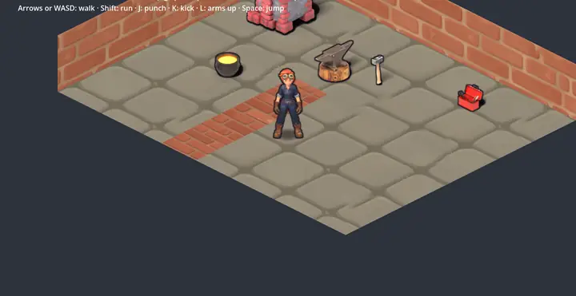

# Demo: el taller de Cris

Un proyecto de Godot 4 chico con los ejemplos de AssetCrisol: Cris camina por su taller en isométrico, entre el horno,
el yunque, el crisol, la caja de herramientas y el martillo, sobre el piso y las paredes del tema `taller`. Sirve para
ver cómo se usa lo que sale de AssetCrisol en un juego.



*English below.*

## Correrla

Los assets no vienen en el repo (son la salida de los pasos): `preparar.sh` los genera desde `ejemplos/` y los instala
acá. Hace falta AssetCrisol instalado (alcanza el nivel mínimo: solo renderiza con Blender, sin IA) y Godot 4.4 o más
nuevo, con su ruta en `config.json` (`godot`): `--instalar` lo usa para importar.

```bash
cd demo
./preparar.sh               # ~5 min: blender, sprites e iso de Cris y sus objetos, tema del taller, godot --instalar acá
godot --path .              # (la ruta de `godot` de tu config.json) o abrir project.godot en el editor
```

Si en tu `datos_dir` no están los ejemplos, `preparar.sh` los copia de `ejemplos/` (no pisa los que ya estén).

| tecla | |
|---|---|
| flechas o WASD | caminar (Shift: correr) |
| J / K / L | golpe / patada / brazos arriba |
| Espacio | salto |

## Cómo está hecha

- `taller.gd` arma la escena: el piso y las paredes son polígonos con las texturas de detalle del tema y su color
  (`detalle.gdshader`: color × detalle × 2 en lineal, README > *Escenarios*); los objetos son sus `*_iso.tscn`
  (`StaticBody2D` con la huella como colisión) y todo va en un nodo con `y_sort_enabled`, porque el origen de cada
  cosa es su base.
- `cris.gd` es un `CharacterBody2D` con `cris_iso.tscn` adentro: le pasa a `set_animacion(nombre, velocidad)` la
  animación y la dirección en pantalla, y el visual elige la más cercana de las 8. La sombra la dibuja el visual.
- 1 unidad = 1 metro y una baldosa de 1×1 mide 128 px de ancho (`baldosa_px` del estilo).
- Las texturas del tema se leen como imagen (preparar.sh las copia sin pasar por el importador): en el editor y al
  correrla anda, pero exportar la demo necesitaría importarlas y cargarlas con `load()` (Godot avisa al correrla).

---

# Demo: Cris's workshop

A small Godot 4 project with AssetCrisol's examples: Cris walks around her workshop in isometric view, among the
furnace, the anvil, the crucible, the toolbox and the hammer, on the floor and walls of the `taller` theme.

The assets are not in the repo (they are the steps' output): `preparar.sh` builds them from `ejemplos/` and installs
them here. You need AssetCrisol installed (the minimum level is enough: it only renders with Blender, no AI) and
Godot 4.4 or newer, with its path in `config.json` (`godot`): `--instalar` uses it to import.

```bash
cd demo
./preparar.sh               # ~5 min: blender, sprites and iso for Cris and her props, the workshop theme, godot --instalar here
godot --path .              # (the `godot` path in your config.json) or open project.godot in the editor
```

Arrows or WASD to walk (Shift to run), J / K / L to punch / kick / raise arms, Space to jump.
