# `crisol ui` manual

*Español: [ui.md](ui.md)*

AssetCrisol turns an idea (a description or an image) into an animated character, a prop, a vehicle or a scene ready
for a game. This manual is about using it **from the browser**, with no terminal and no config files. The full
reference (every option, the command line, AI agents) is in the [README](../README.en.md).

1. [Before you start](#0-before-you-start)
2. [Your first character, start to finish](#1-your-first-character-start-to-finish)
3. [Looking at the result](#2-looking-at-the-result)
4. [When something goes wrong](#3-when-something-goes-wrong)
5. [Settings](#4-settings)
6. [Other kinds of asset](#5-other-kinds-of-asset)
7. [Motions (Kimodo)](#6-motions-kimodo)
8. [Taking it to your game](#7-taking-it-to-your-game)
9. [Queue, library and batch work](#8-queue-library-and-batch-work)
10. [Licenses in two minutes](#9-licenses-in-two-minutes)

## 0. Before you start

**What it is.** A page that runs on your PC: no accounts, nothing is uploaded and the AI models run on your graphics
card. Three rules you will see all through this manual:

- **You decide.** When there is a choice to make (the image, the mesh, the textures), the page shows you the options
  and waits. Nothing is picked for you.
- **One thing at a time on the graphics card.** Steps that generate wait their turn in the
  [queue](#8-queue-library-and-batch-work), also when another program is using the card.
- **Every step can be redone or undone** without losing the rest.

**Opening it.** With AssetCrisol installed ([README > Start here](../README.en.md#start-here)), in a terminal:

```bash
crisol ui
```

It opens `http://127.0.0.1:8190/` in the browser. That is the only command in this manual. To use it from your phone
or another PC at home, `crisol ui --host 0.0.0.0` prints an address with a code (`?token=...`): open it on the phone
and it is remembered.

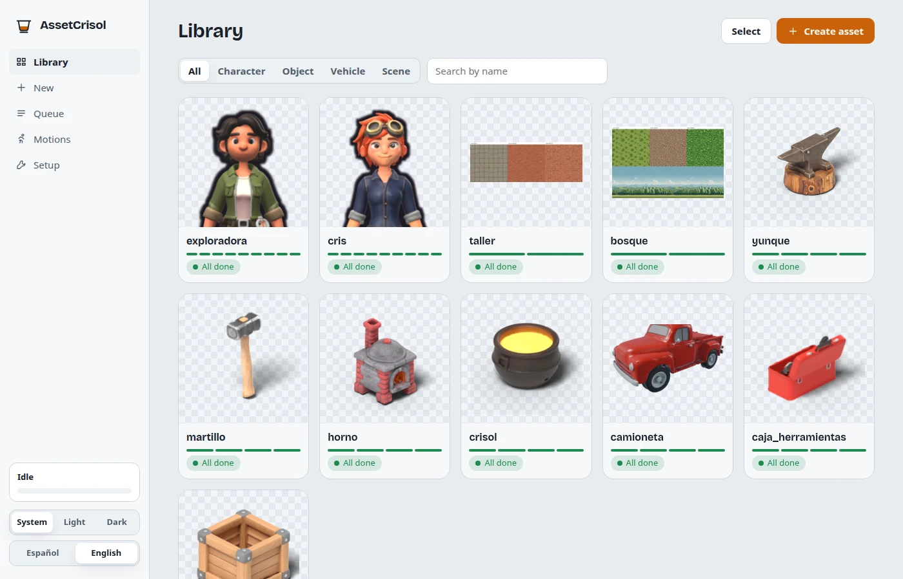

The menu is on the left: **Library** (your assets), **New**, **Queue** (what is running and what finished),
**Motions** (AI animation clips) and **Setup**. At the bottom: what the card is doing now, the theme (light or dark)
and the language.

| Dark | Phone |
| --- | --- |
| 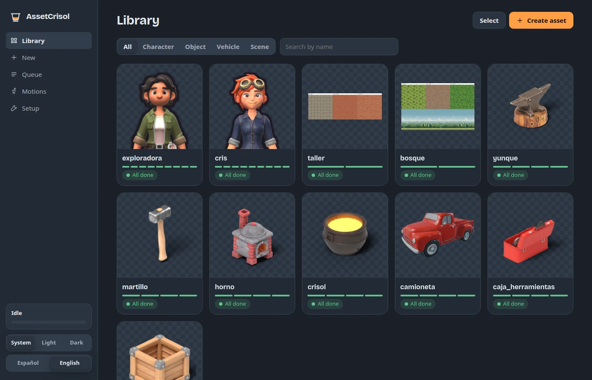 | 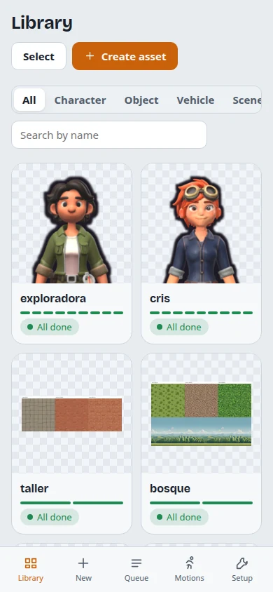 |

**Setup** shows which steps can run on this PC. If one is missing a model or a program, it shows up disabled with the
reason and how to fix it; everything else still works.

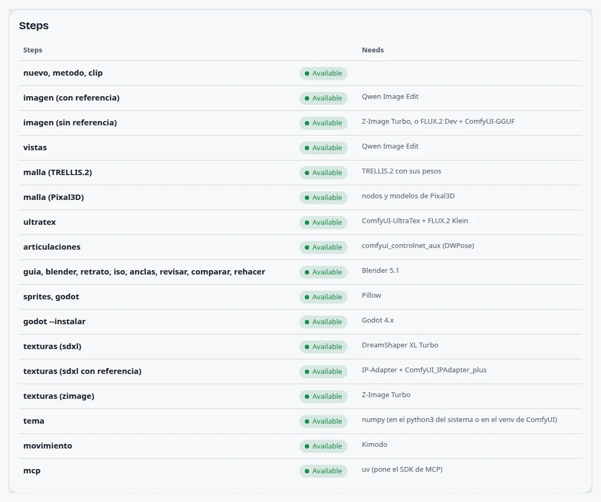

## 1. Your first character, start to finish

Let's make the *explorer*: a young woman with a green jacket and boots, from a description, with no reference image.
About 15 minutes of graphics card time and three decisions from you.

### Create

**New** (or **Create asset**), then:

1. **What do you want to make**: *Person*. Each card is a recipe prepared for that kind of asset; when in doubt,
   Person.
2. **Reference image**: optional. A photo or a sketch works as a base; with no image, it is made up from the
   description.
3. **Description**, **in English** (it goes straight to the image model): clothes, colors, materials. Ask for the arms
   a little away from the body, and avoid loose pieces (backpacks, holsters, capes): they merge with the body when it
   moves.
4. **Style**: *The recipe default* works almost always. The others change the world and the finish (medieval,
   futuristic, semi-realistic...); it can be changed later in Settings.
5. **Name**: lowercase letters, numbers and underscore. It is the folder name.

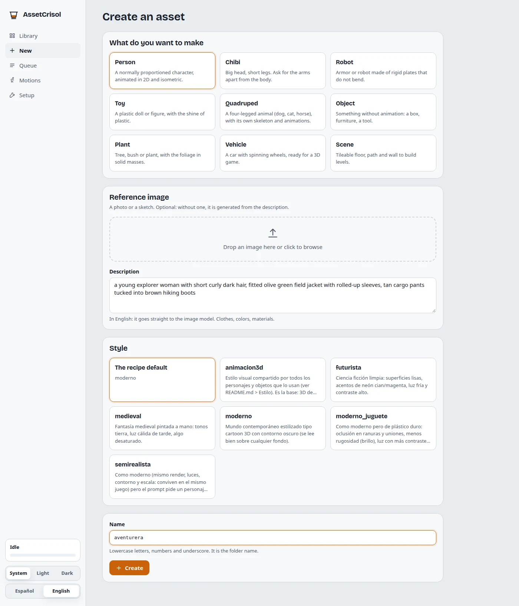

*(The screenshot uses another name because the explorer already exists.)*

**Create** takes you to the asset page.

### The chain of steps

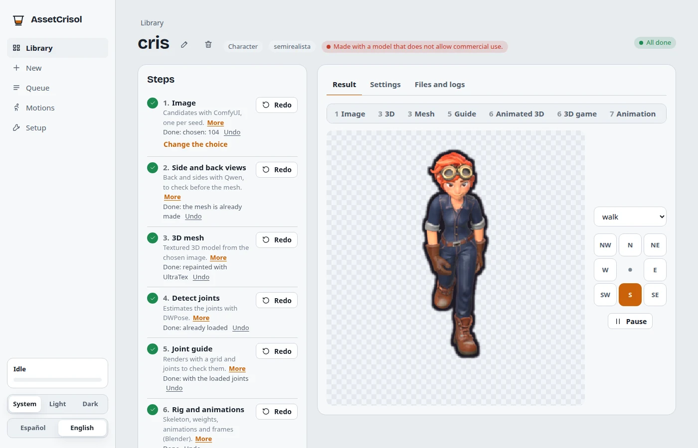

On the left is the **chain of steps**, numbered in order. Each has a line saying what it does; **More** opens what to
look at afterwards, what to try if it goes wrong and the link to its README section. The state of each step:

- **To do**: not run yet.
- **Done** (green tick): finished and up to date.
- **Outdated**: it ran, but something it depends on changed later (another choice, a setting). It needs redoing.

The big button at the top right (**Next: …**) always runs the step that comes next. The **Result** tabs carry the
number of the step that made them.

### Pick the image

**Next: Image** makes four candidates (about 20 seconds each). When they are done, **Your call** shows up at the top:

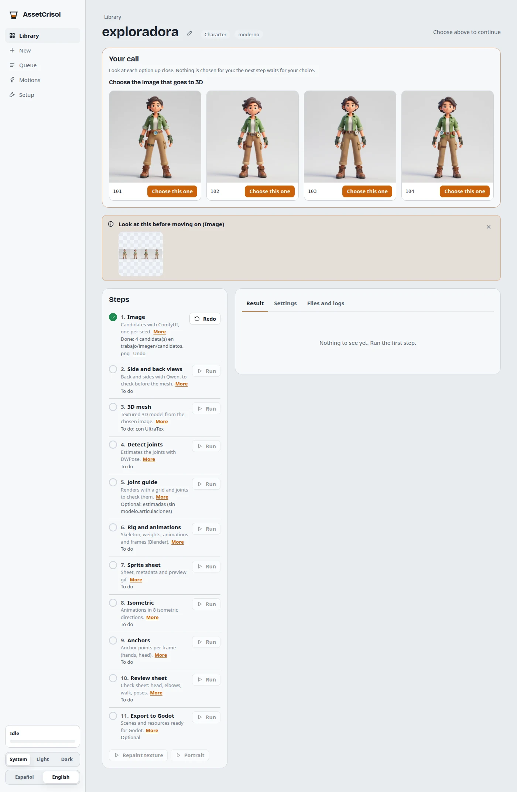

What to look for, because it carries all the way to the end:

- **Full body, from the front**, with believable proportions.
- **Arms away from the body and legs slightly apart**: whatever touches in the image comes out stuck together in 3D.
- **No loose or dangling pieces**: in this batch, 101 has a thigh holster and 104 a dangling compass. We picked
  **103**: symmetrical, free arms, everything close to the body.

If none convinces you, try other seeds (Settings > Image > Seeds) before changing the description. The choice can be
changed later with **Change the choice**, in the step.

If one is almost there but has a detail that doesn't work (a holster, squinting eyes, another hair color), use **Fix**
on that candidate: write what to change, in English and a few things at a time ("remove the thigh holster", "green
eyes"). Two new images come out (`edit_1`, `edit_2`, about 40 seconds) next to the others, with the request under them;
the original stays. Pick one like any candidate; a fix can be fixed again too.

### Check the views

**Next: Side and back views** draws the character from the back and the sides (about a minute). The mesh uses
those views, so look at them before going on:

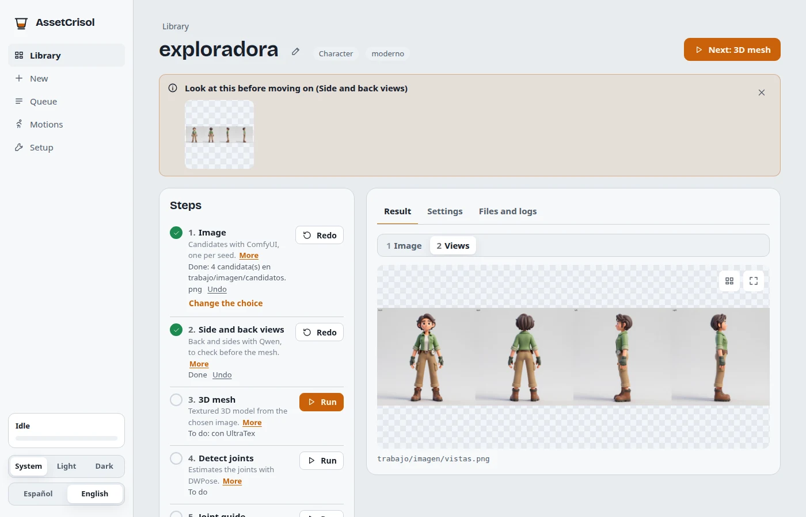

- The **back** must not repeat what is on the chest (a pocket, a logo).
- Each **side** faces its own edge, with what is on that side: here the compass, worn on the left, shows only in the
  left view.

If one comes out wrong, delete it in **Files and logs** and run the step again: it only redoes the missing one.

### Pick the mesh

**3D mesh** builds the textured 3D model (3 to 8 minutes). Before running it you can ask for **candidates** to
compare: in **Settings > Mesh**, *Add TRELLIS.2* (another engine) or *Add Pixal3D* (another seed). For the explorer we
added a TRELLIS.2 candidate next to the main one (Pixal3D + UltraTex).

When they are done, **Your call** shows a card per candidate, all from the same angle, with **View in 3D** to spin it:

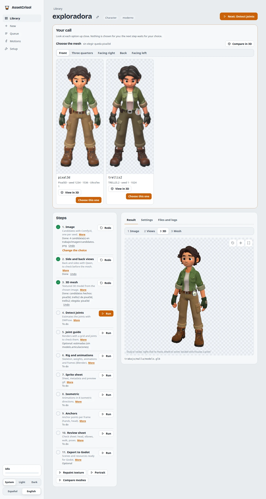

Look at the **face up close**, the **back** and any **holes**. For the explorer we picked **trellis2**: darker, but
cleaner, above all in the face. The seed matters a lot: if none convinces you, try two or three more seeds before
touching anything else. Once you pick, that mesh becomes the asset's right away (nothing is generated again): next
comes **Joints**.

### Joints, rig and the rest

From here on the steps are quick (seconds to a minute each) and **Next** runs them in order:

- **Detect joints** finds shoulders, elbows, hips and knees with DWPose.
- **Joint guide** draws them on the model so you can check them (see [3. When something goes wrong](#3-when-something-goes-wrong)).
- **Rig and animations** adds a skeleton, works out how each bone moves the mesh and builds the animations.
- **Sprite sheet**, **Isometric** and **Anchors** render what goes into the game.
- **Review sheet** puts what fails most often into one image: it is the last thing to check
  ([2. Looking at the result](#2-looking-at-the-result)).
- **Export to Godot** is optional: it leaves a folder ready for a Godot project.

While something runs, the **Queue** shows the step, the estimated time and what it is writing. No need to stay and
watch: you can go on with another asset, and if you close the page the step keeps going.

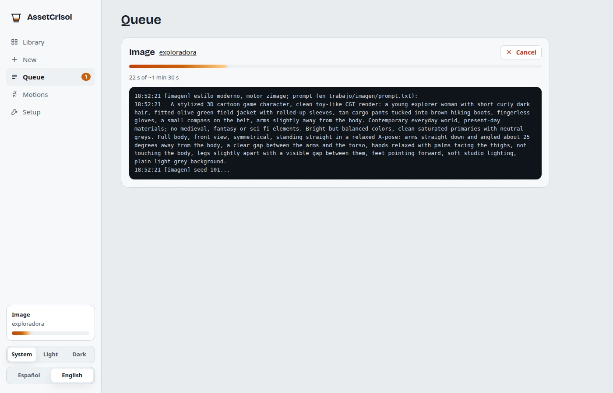

## 2. Looking at the result

The asset's **Result** tab has a sub-tab for each thing made, with the number of the step that made it. The examples
here are of *Cris*, the protagonist of AssetCrisol's examples.

**Isometric**: the character in 8 directions. Pick the animation at the top and the direction on the compass rose;
this is what an isometric game shows.

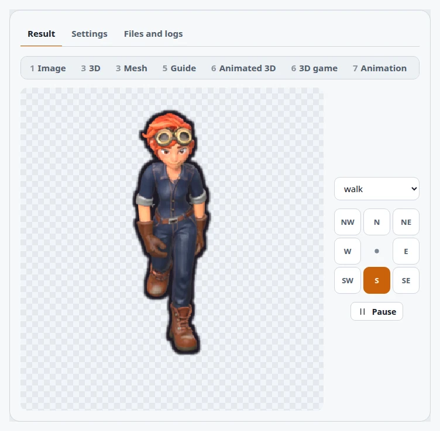

**Animated 3D**: the model with its skeleton, in the animation you pick and at the pace of the sprites. Drag to spin
it, wheel or two fingers to zoom, right click (or two fingers) to move the camera and double click to focus a point
(the face, a foot). Handy to look at an elbow or a knee from any side.

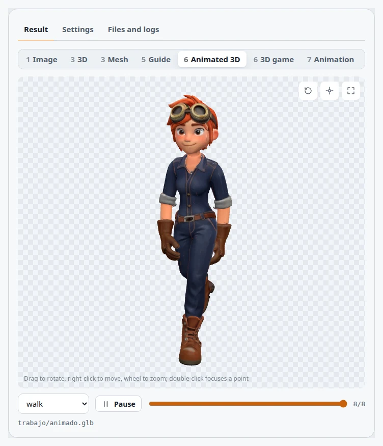

**Animation**: the side sheet, animated one animation at a time, with pause and a bar to step frame by frame.

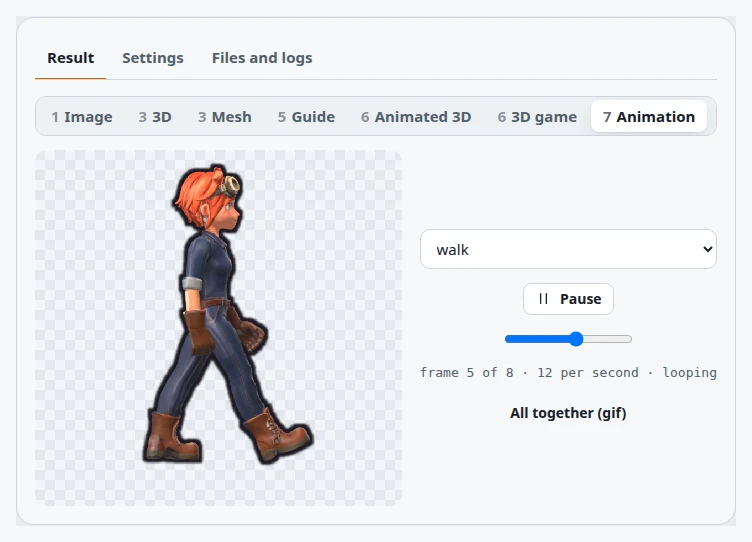

**Portrait**: the cropped face and the body from the front, for dialogs or menus.

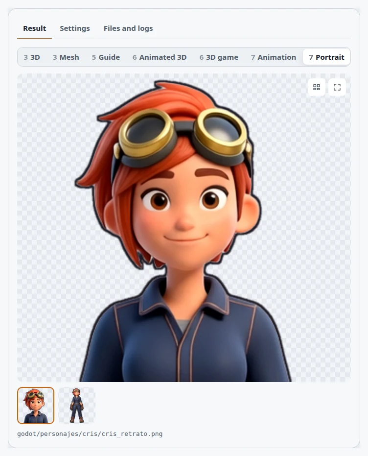

**Edit the framing** (under the portrait): a box over the whole image, or over the model from the front, that you
drag and make bigger or smaller from the corner (also with the arrows and + −), with the preview next to it. **Save
and redo the portrait** redoes it in seconds; **Automatic** goes back to the framing the rig computes. It warns when
the image crop is so small it will look blurry, and when you later change the chosen image.

**3D game**: the reduced model for a 3D game, in three levels of detail (LOD), with its faces and file size. *Show
faces* draws it as a wireframe.

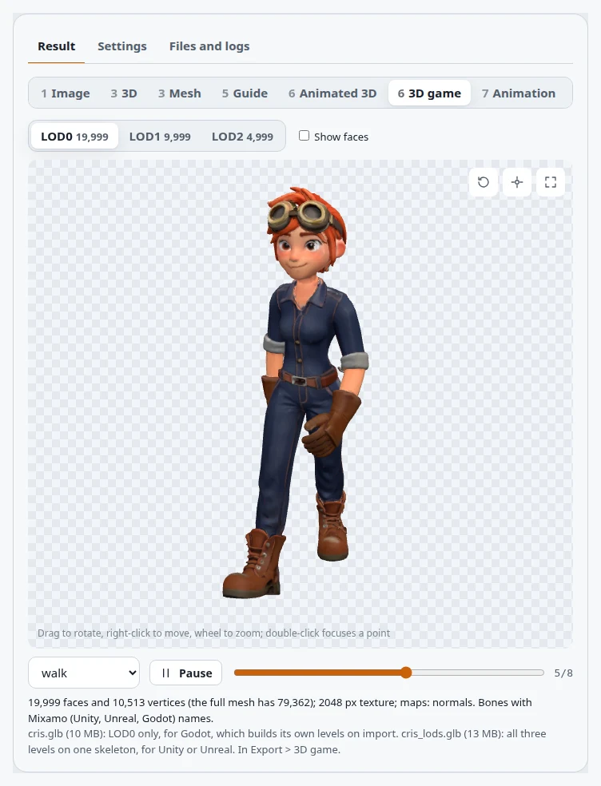

**Review**: the check sheet. The walk from the front and the back, the head from the side, the bent elbows, the key
poses and, in magenta, what shows of the mesh **inside** (clothes going through each other, holes). It warns when the
inside goes over 3 % in a pose. The **close-up review**, next to it, shows elbows, shoulders, knees and face in the
poses that bend them most.

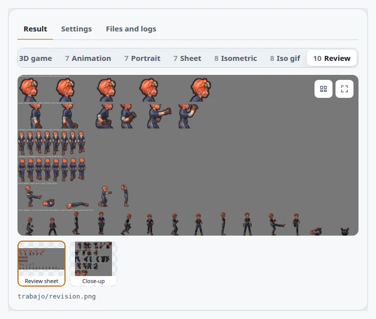

## 3. When something goes wrong

Almost everything is fixed by redoing a step with another setting. Before touching anything, **More** in the step
says what to look at and what to try:

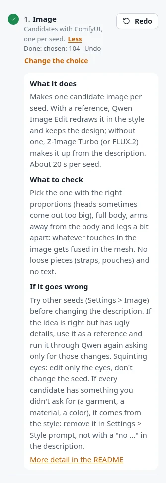

| What you see | Where | What to try |
| --- | --- | --- |
| The image has something you did not ask for in every seed (a garment, a material) | Image | It comes from the style: Settings > *Style prompt* |
| The back copies the chest | Views, Mesh | Delete the bad view and redo Views; for the mesh, *Paint the back with the Qwen view* |
| Smudged face or odd eyes | Mesh | Another *UltraTex seed*; with TRELLIS.2, try Pixal3D + UltraTex |
| Holes or missing pieces | Mesh | Another mesh seed (as a candidate, to compare) |
| Knees bending backwards, arms twisting | Guide | The joints: check them in the guide and move them by hand |
| Elbows squashing like putty | Close-up review | README > [When weights fail](../README.en.md#when-weights-fail) |
| Raising the arm, the trousers or the fingers stretch like shards | Review (punch, throw, arms up) | The hands touched the thighs at rest. *Edit the full json*: `modelo.pesos_zonas`, boxes that send the trousers to the thigh and the whole hand to the hand (README > [When weights fail](../README.en.md#when-weights-fail)) |
| Large magenta patches in the review | Review | Clothes going through each other or holes: another mesh |
| The face looks up or down | Isometric | Settings > Model > *Head up* (negative raises the face) |
| Clothes look like polished plastic | Everything | The `moderno_juguete` style is for toys: switch to `moderno` and redo from Rig |
| It looks too small or too big in the game | Sprites | Settings > Sprites > *On-screen height* |

**Joints.** If they are wrong, everything after them is wrong. The **Guide** tab shows them on the model, from the
front and the side: each point has to land in its place on the body (shoulders, elbows, wrists, hips, knees, ankles).

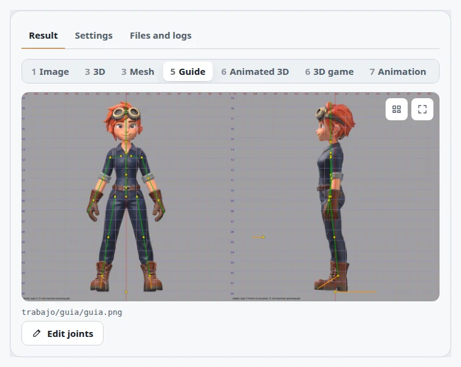

**Edit joints** opens the editor to drag them (or move them with the arrow keys). From the front, one side is mirrored
to the other. Saving leaves Rig and animations to redo.

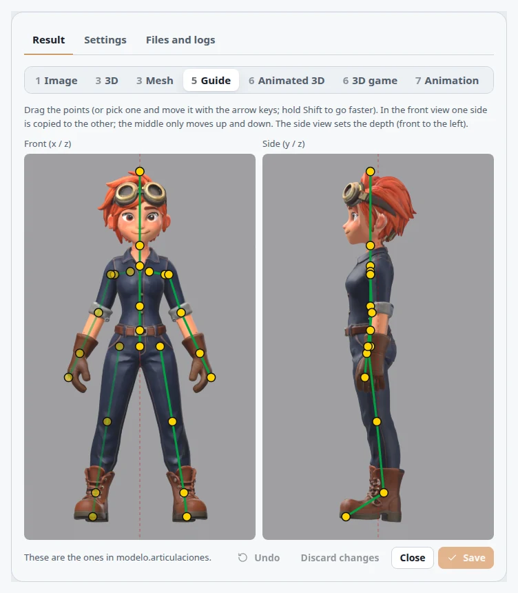

**Undo** (in each step, next to its state) deletes what that step made. Before doing it, it shows which files it will
delete and how much they weigh. It does not touch your choices or your settings.

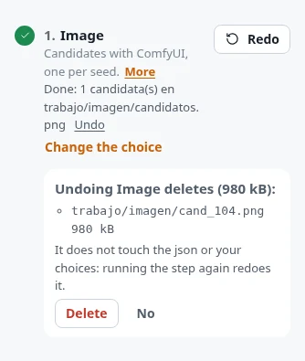

**Outdated** is not an error: you changed something the step depends on (a choice, a setting) and it needs redoing.
**Next** redoes what went stale, in order.

## 4. Settings

The asset's **Settings** tab changes the common things without touching files. When you save, the affected steps go
outdated. At the bottom, **Edit the full json** is the advanced mode (it shows the changes before saving); nothing in
this manual needs it.

**Style**: how everything looks (the image and the render). `moderno` and `semirealista` for people,
`moderno_juguete` only for plastic toys.

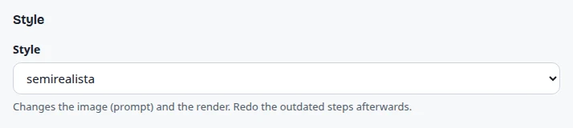

**Style prompt**: the parts of the request to the image model that come from the style (technique, theme, palette,
light and background), with the full request that comes out. They can be edited or removed for this asset only.

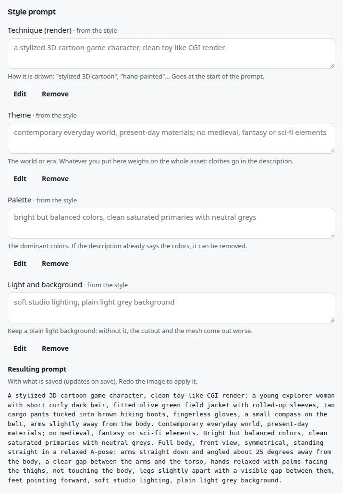

**Image**: the description and the seeds (one candidate per seed).

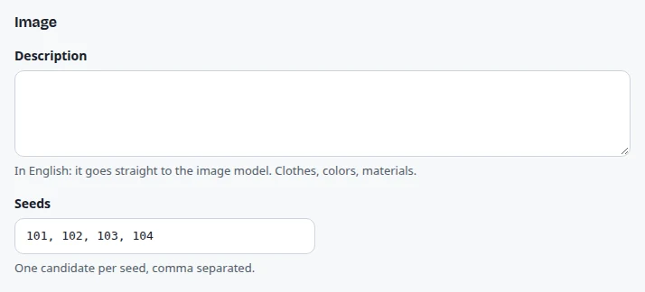

**Mesh**: engine, seed and resolution, and the **candidates** to compare (each inherits whatever it does not change
from the main one). *Generate the missing ones* only runs the new ones.

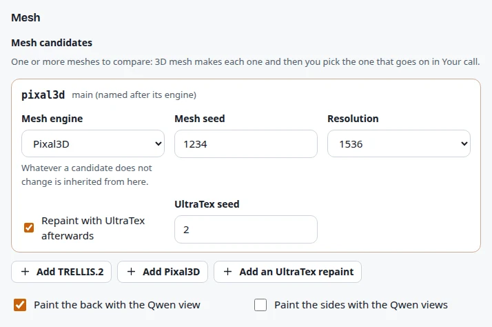

**Model**: the height in meters (the scale of everything), the tilt of the head and *Straighten the single-view Pixal3D mesh*
(on for props and quadrupeds: it comes out tilted like the camera).

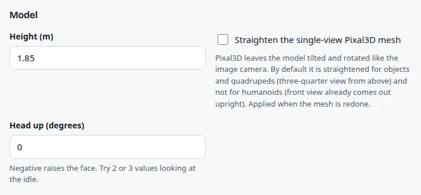

**Sprites**: on-screen height, iso tile and the quality of each sheet, with the size it will have in the game, and the portrait zoom (for when wings or a backpack leave the head small).

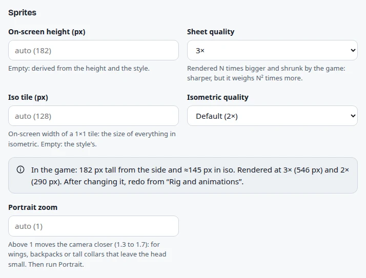

**Animations**: which are rendered in isometric (fewer animations, smaller files) and what each one is built from:
*procedural* (computed poses) or *kimodo* (an AI motion clip, see [6. Motions](#6-motions-kimodo)).

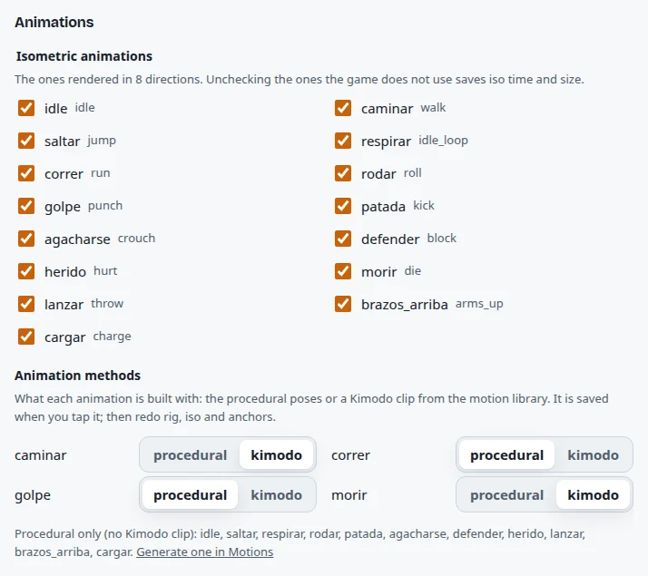

**3D game**: whether the model is exported for a 3D game, the quality of each level of detail, the texture, the maps
and the bone names (Mixamo, which Unity, Unreal and Godot recognize).

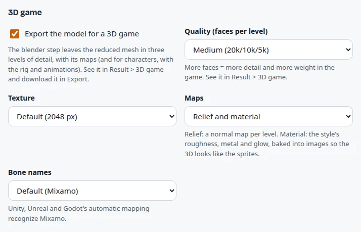

## 5. Other kinds of asset

They all follow the same idea (create, run the steps, choose, look at the result). Only the chain changes:

- **Object** (a crate, a tool, a piece of furniture): image, mesh, view render and sheet. No skeleton.
  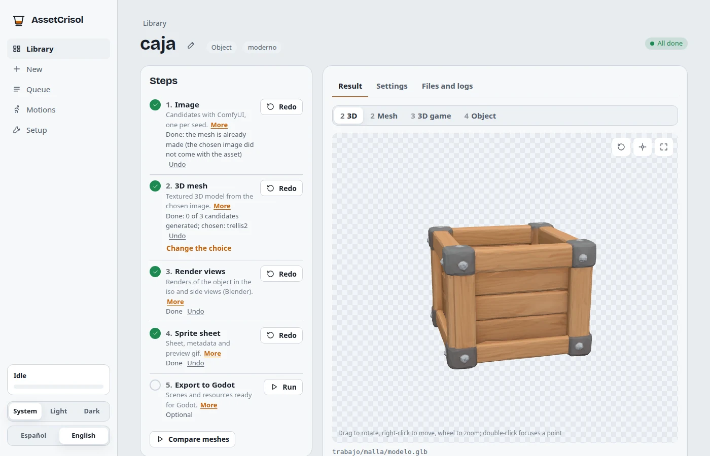
- **Vehicle**: like an object, but it separates the wheels so they spin and builds a model with the body and the four
  wheels. The recipe assumes a car.
  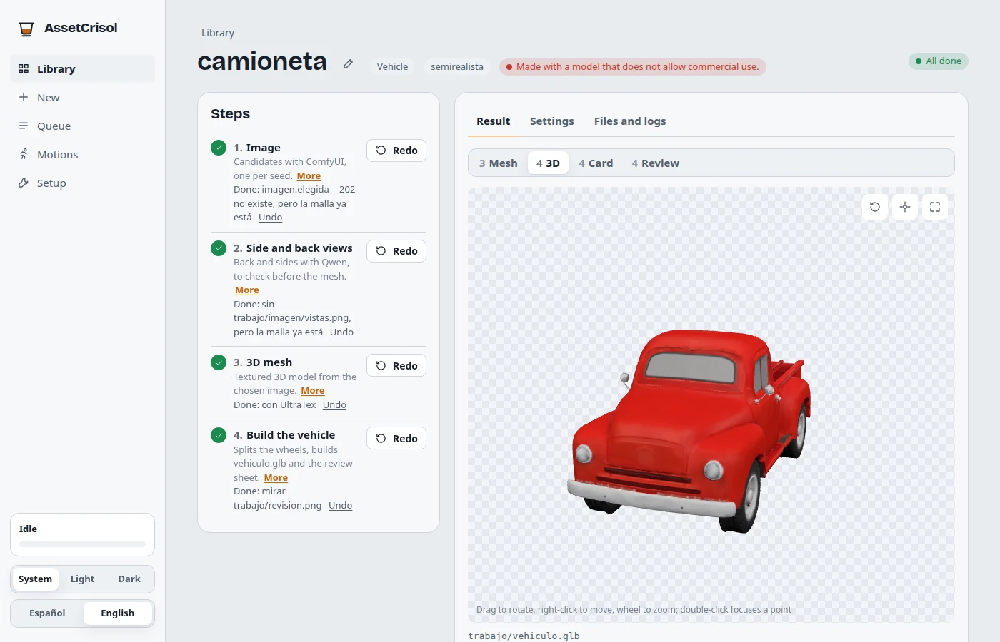
- **Scene** (floor, path and wall that tile): **Textures** makes candidates for each one, you pick in *Your call* and
  **Scene theme** builds the tileables and the colors.
  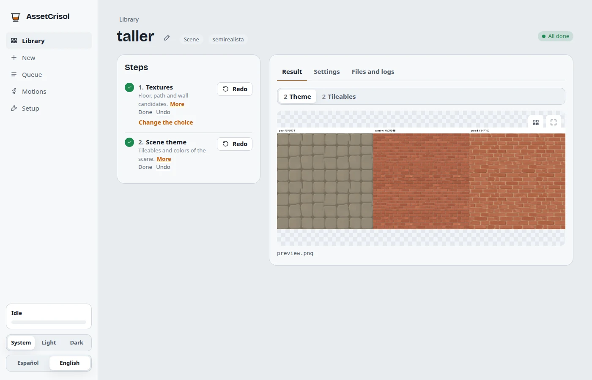
- **Chibi, Robot, Toy**: people with another recipe (big heads, rigid plates that do not bend, plastic shine). The
  chain is a person's.
- **Quadruped** (dog, cat, horse): its own skeleton with four legs and a tail, and 8 animations. Joints are estimated
  from the mesh. Mesh with TRELLIS.2: with Pixal3D it animates badly.
- **Plant**: trees and bushes with foliage in masses, no loose leaves.

## 6. Motions (Kimodo)

Animations come from computed poses (*procedural*), except the ones that use a **Kimodo clip**: a motion generated by
AI from an English sentence ("a person walks forward confidently"). It wins on full-body motions (walking, running,
dying) and loses on punches; it is chosen per animation in Settings > Animations.

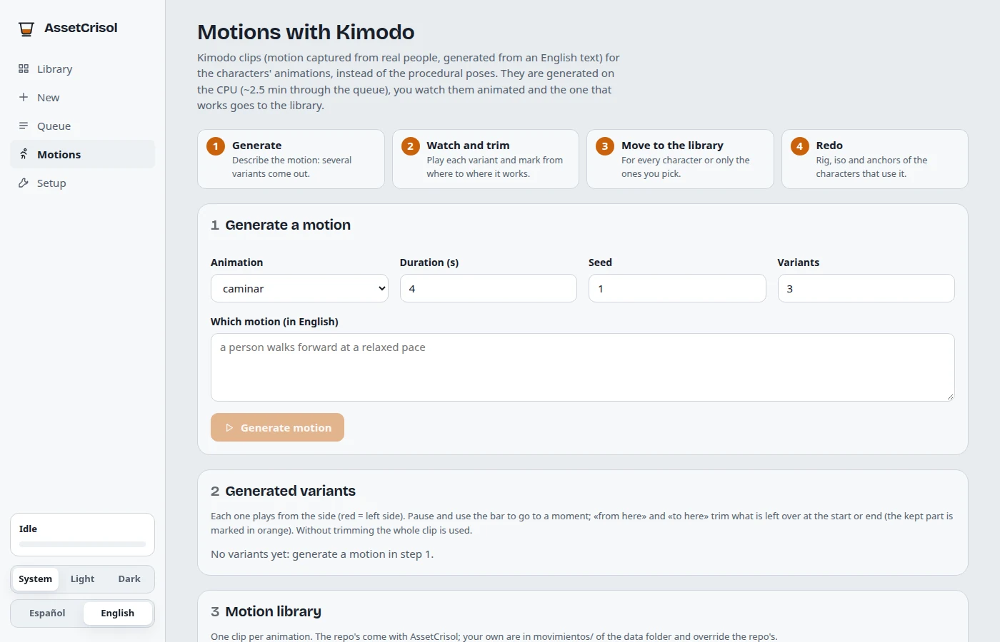

In **Motions**:

1. **Generate**: the sentence, the length and how many variants. It runs on the processor, not the graphics card.
2. **Look**: each variant with an animated skeleton (this is how a library clip looks):

   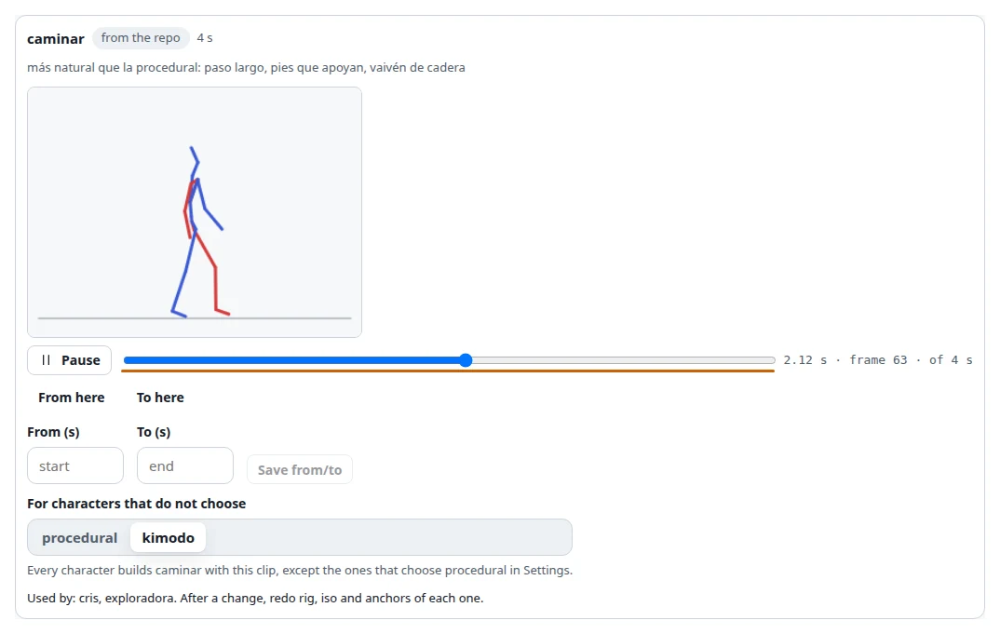

3. **Trim**: mark a moment with *From here* and *To here*. For walking or running, one cycle: from one foot landing to
   the next landing of the same foot.
4. **Send to the library** as an animation (walk, run...). It says which characters use it; then, in each one, redo
   Rig, Isometric and Anchors.

## 7. Taking it to your game

**Files and logs > Export**: tick what to download and **Download zip**. It also works from a phone or another PC.

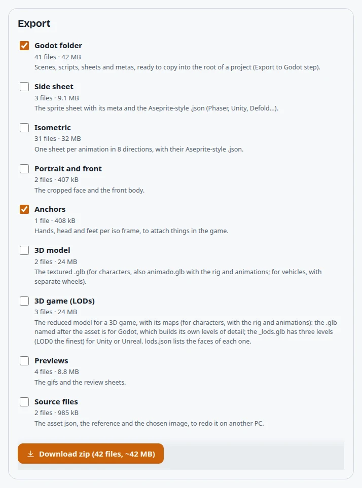

- **Godot folder**: scenes, scripts, sheets and metadata, to copy to the root of a Godot project. How to use it:
  README > [Godot guide](../README.en.md#godot-guide).
- **Side sheet** and **Isometric**: the sprite sheets with an Aseprite-style `.json`, which Unity, Phaser, Defold and
  most 2D engines read.
- **Portrait and front**, **Anchors** (where the hands and head are in each frame, to hang a sword or a helmet on).
- **3D model** and **3D game (LODs)**: the textured `.glb` and the reduced one for a 3D game, with skeleton and
  animations for characters.
- **Source files**: the json, the reference and the chosen image, to rebuild the asset on another PC.

## 8. Queue, library and batch work

**Queue**: the running step (with its live log and **Cancel**), the waiting ones and the history of finished ones,
each with its log. The history can be cleared entirely or in parts. If you close `crisol ui`, the running step goes on
and the waiting ones start when you open it again.

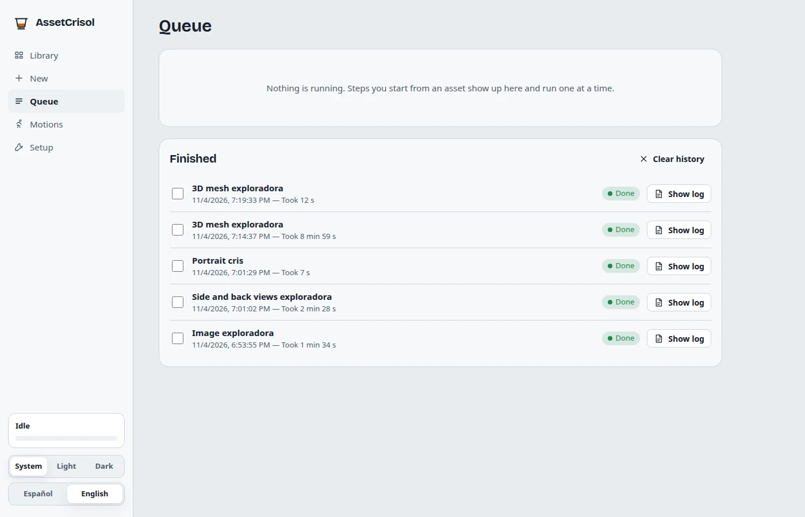

**Library**: filters by kind and search by name. Each card shows the step bar and what comes next (or whether you have
a choice to make). **Select** marks several characters to redo in a batch (rig, sprites, iso, anchors and review),
for example after changing an animation.

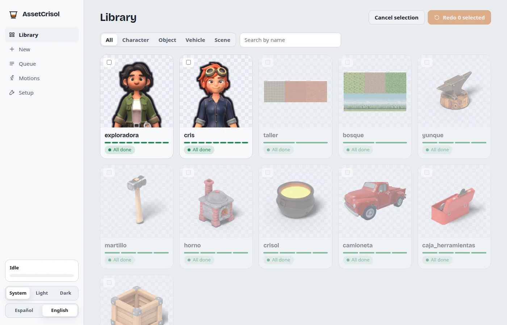

**Rename**: the pencil next to the asset name. It renames the folder and its files; whatever you already copied into a
game keeps the old name.

**Delete**: the bin next to the name. It tells how much space the asset takes and, once confirmed, moves it to the
**trash** (Library > Trash, the button shows up when there is something in it). From there you **restore** it as it
was or delete it forever, one by one or all at once. Whatever you already copied into a game does not change.

## 9. Licenses in two minutes

AssetCrisol's code is free software (GPL-3.0), but **each AI model has its own license**, and some do not allow
commercial use of what they make. Each asset page warns about it at the top, next to the name (*Made with a model that
does not allow commercial use*), and **Files and logs > Licenses** says which models made it. The *Person* recipe
repaints the texture with UltraTex (FLUX.2 Klein), which is **not commercial**: for a game you are going to sell, in
Settings > Mesh untick *Repaint with UltraTex afterwards* (the engine's texture stays, poorer) and redo from the mesh.

Details per model and FAQ: [docs/licenses.md](licenses.md). It is a guide, not legal advice.

---

### Rebuilding the screenshots

The images in this manual come from `tests/capturas_ui.py` (it needs `uv`, which brings Playwright, and `google-chrome`), with the UI running on a separate data folder (never your
working one): the examples with their steps done and the explorer from chapter 1.

```bash
# test config: a copy of config.json with "datos_dir" in a new folder
cp -r ejemplos/* <data>/
ASSETCRISOL_CONFIG=<config> crisol rehacer cris          # and blender/sprites/iso for each object, tema for each scene
ASSETCRISOL_CONFIG=<config> crisol ui --puerto 8191 --no-abrir
python3 tests/capturas_ui.py                             # all of them, es and en; --solo a,b for some; --lista
```

The chapter 1 ones (`--lista` marks them as moments) show the explorer at a point along the way (before picking the
image, with the mesh running): take them with `--solo` when she gets there.
