# Manual de `crisol ui`

*English: [ui.en.md](ui.en.md)*

AssetCrisol convierte una idea (una descripción o una imagen) en un personaje animado, un objeto, un vehículo o un
escenario listo para un juego. Este manual es para usarlo **desde el navegador**, sin terminal ni archivos de
configuración. La referencia completa (cada opción, la terminal, los agentes de IA) está en el [README](../README.md).

1. [Antes de empezar](#0-antes-de-empezar)
2. [Tu primer personaje, de punta a punta](#1-tu-primer-personaje-de-punta-a-punta)
3. [Ver el resultado](#2-ver-el-resultado)
4. [Cuando algo sale mal](#3-cuando-algo-sale-mal)
5. [Ajustes](#4-ajustes)
6. [Otros tipos de asset](#5-otros-tipos-de-asset)
7. [Movimientos (Kimodo)](#6-movimientos-kimodo)
8. [Llevarlo al juego](#7-llevarlo-al-juego)
9. [Cola, biblioteca y trabajo en lote](#8-cola-biblioteca-y-trabajo-en-lote)
10. [Licencias en dos minutos](#9-licencias-en-dos-minutos)

## 0. Antes de empezar

**Qué es.** Una página que corre en tu PC: no hay cuentas, no se sube nada a internet y los modelos de IA corren en tu
placa de video. Tres reglas que vas a ver en todo el manual:

- **Vos decidís.** Cuando hay que elegir (la imagen, la malla, las texturas), la página te muestra las opciones y
  espera. Nada se elige solo.
- **Una cosa por vez en la placa de video.** Los pasos que generan esperan su turno en la [cola](#8-cola-biblioteca-y-trabajo-en-lote),
  también si otro programa está usando la placa.
- **Cada paso se puede rehacer o deshacer** sin perder lo demás.

**Abrirla.** Con AssetCrisol instalado ([README > Empezá acá](../README.md#empezar)), en una terminal:

```bash
crisol ui
```

Se abre `http://127.0.0.1:8190/` en el navegador. Es el único comando de este manual. Para usarla desde el celular u
otra PC de la casa, `crisol ui --host 0.0.0.0` imprime una dirección con un código (`?token=...`): abrila en el
celular y queda recordada.

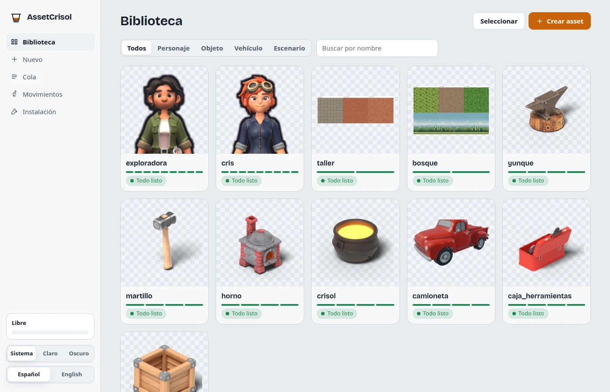

A la izquierda está el menú: **Biblioteca** (tus assets), **Nuevo**, **Cola** (lo que está corriendo y lo que
terminó), **Movimientos** (clips de animación con IA) e **Instalación**. Abajo, qué está haciendo la placa ahora, el
tema (claro u oscuro) y el idioma.

| Oscuro | Celular |
| --- | --- |
| 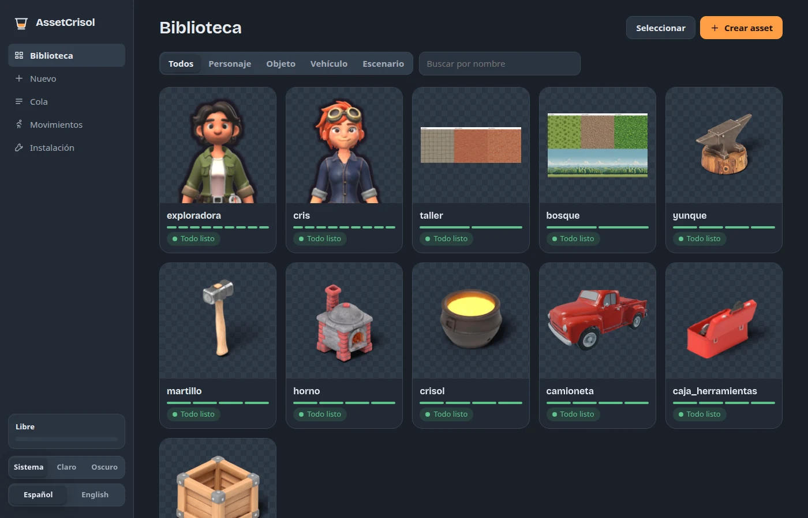 | 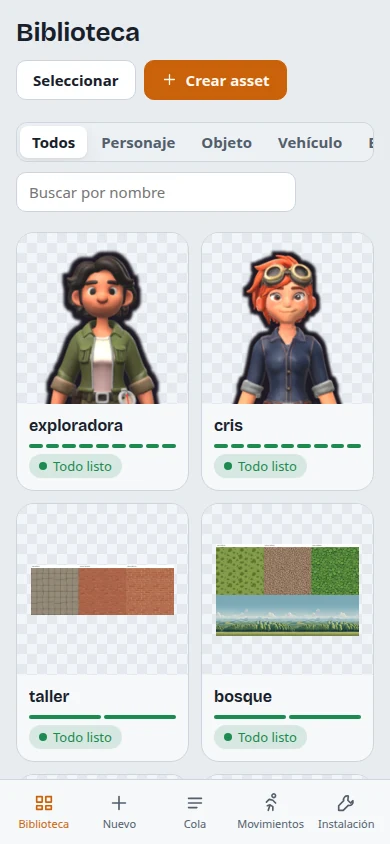 |

**Instalación** muestra qué pasos se pueden correr en esta PC. Si a uno le falta un modelo o un programa, aparece
apagado con el motivo y cómo arreglarlo; el resto anda igual.

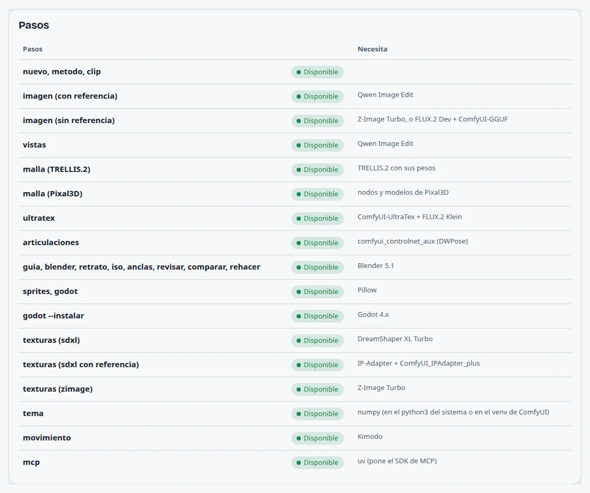

## 1. Tu primer personaje, de punta a punta

Vamos a hacer a la *exploradora*: una chica con chaqueta verde y botas, desde una descripción, sin imagen de
referencia. En total son unos 15 minutos de la placa y tres decisiones tuyas.

### Crear

**Nuevo** (o **Crear asset**) y:

1. **Qué querés hacer**: *Persona*. Cada tarjeta es una receta preparada para ese tipo de asset; si dudás, Persona.
2. **Imagen de referencia**: opcional. Una foto o un boceto sirve de base; sin imagen, se inventa desde la descripción.
3. **Descripción**, **en inglés** (va directo al modelo de imagen): ropa, colores, materiales. Conviene pedir los
   brazos un poco separados del cuerpo y evitar piezas sueltas (mochilas, cartucheras, capas), que después se
   funden con el cuerpo al animar.
4. **Estilo**: *El de la receta* sirve casi siempre. Los demás cambian el mundo y el acabado (medieval, futurista,
   semirrealista...); se puede cambiar después en Ajustes.
5. **Nombre**: minúsculas, números y guion bajo. Es el nombre de la carpeta.

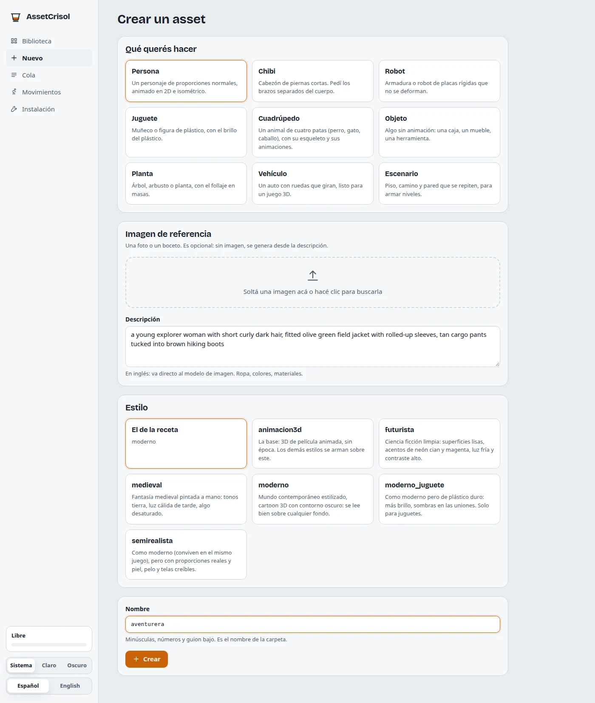

*(En la captura el nombre es otro porque la exploradora ya existe.)*

**Crear** te lleva a la página del asset.

### La cadena de pasos

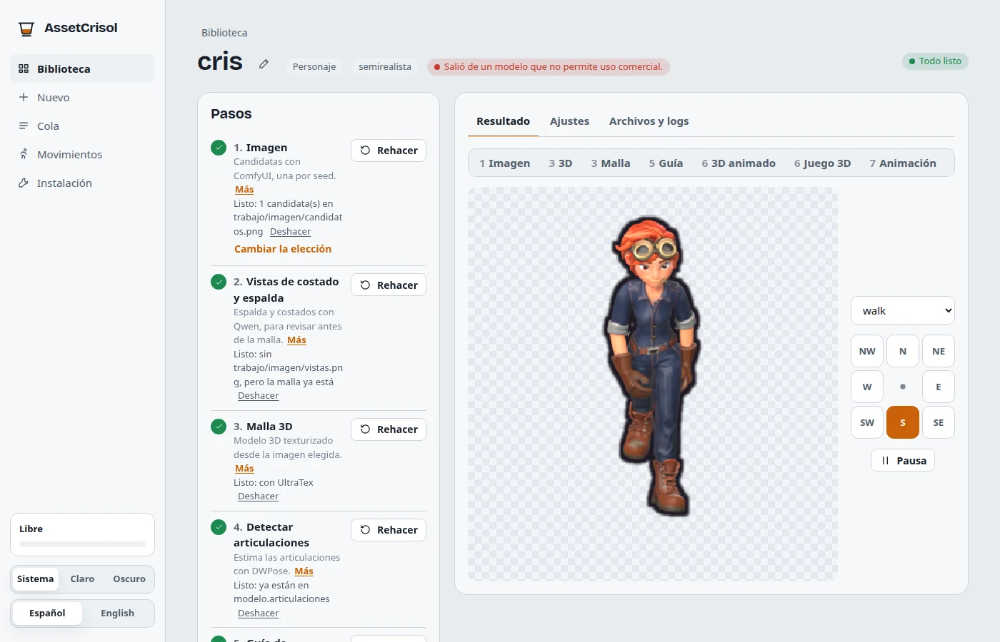

A la izquierda está la **cadena de pasos**, numerada en orden. Cada uno tiene una línea de qué hace; **Más** abre qué
mirar después, qué probar si sale mal y el enlace a su sección del README. El estado de cada paso:

- **Pendiente**: todavía no corrió.
- **Listo** (tilde verde): hecho y al día.
- **Desactualizado**: corrió, pero después cambió algo de lo que depende (otra elección, un ajuste). Hay que rehacerlo.

El botón grande de arriba a la derecha (**Siguiente: …**) siempre corre el paso que toca. Las pestañas de
**Resultado** llevan el número del paso que las generó.

### Elegir la imagen

**Siguiente: Imagen** genera cuatro candidatas (unos 20 segundos cada una). Cuando terminan, arriba aparece
**Te toca elegir**:

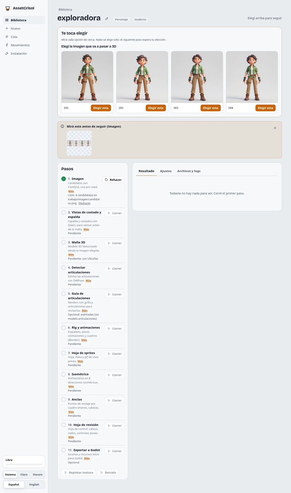

Qué buscar en la imagen, porque se arrastra hasta el final:

- **Cuerpo entero, de frente**, con proporciones creíbles.
- **Brazos separados del cuerpo y piernas un poco abiertas**: lo que se toca en la imagen sale pegado en 3D.
- **Sin piezas sueltas ni colgantes**: en esta tanda, la 101 tiene una funda en el muslo y la 104 una brújula que
  cuelga. Elegimos la **103**: simétrica, brazos libres, todo pegado al cuerpo.

Si ninguna convence, probá otras seeds (Ajustes > Imagen > Seeds) antes de cambiar la descripción. La elección se
puede cambiar después con **Cambiar la elección**, en el paso.

### Mirar las vistas

**Siguiente: Vistas de costado y espalda** dibuja cómo es el personaje de espalda y de costado (un minuto). La
malla usa esas vistas, así que conviene mirarlas antes de seguir:

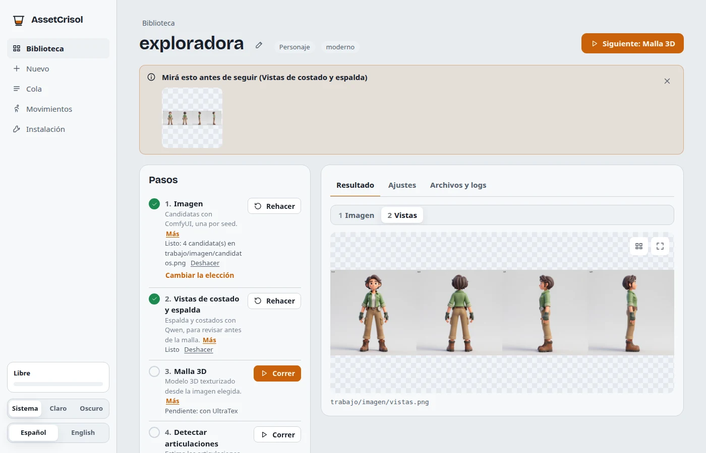

- La **espalda** no tiene que repetir lo del pecho (un bolsillo, un logo).
- Cada **costado** mira hacia su borde, con lo de ese lado: acá la brújula, que va del lado izquierdo, aparece solo en
  la vista izquierda.

Si una sale mal, borrala en **Archivos y logs** y corré el paso de nuevo: rehace solo la que falta.

### Elegir la malla

**Malla 3D** arma el modelo 3D con su textura (entre 3 y 8 minutos). Antes de correrla podés pedir **candidatos** para
comparar: en **Ajustes > Malla**, *Agregar TRELLIS.2* (otro motor) o *Agregar Pixal3D* (otra seed). Para la
exploradora agregamos un candidato de TRELLIS.2 además del principal (Pixal3D + UltraTex).

Cuando terminan, **Te toca elegir** muestra una tarjeta por candidato, todas en la misma vista, con **Ver en 3D** para
girarlo:

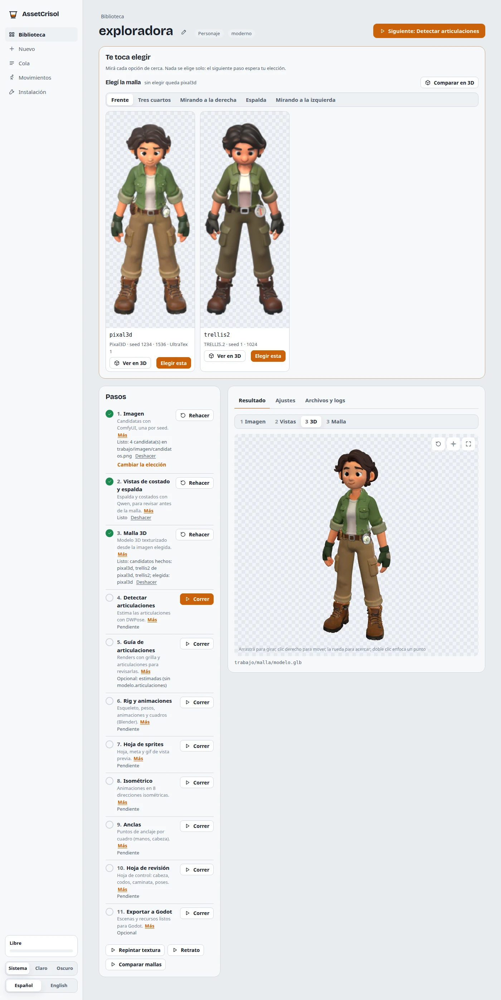

Mirá la **cara de cerca**, la **espalda** y si hay **agujeros**. Para la exploradora elegimos **trellis2**: más oscura,
pero más limpia, sobre todo en la cara. La seed pesa mucho: si ninguno convence, probá dos o tres seeds más antes de
tocar otra cosa. Al elegir, esa malla pasa a ser la del asset en el momento (no se genera de nuevo): lo que
sigue es **Articulaciones**.

### Articulaciones, rig y lo demás

De acá en adelante los pasos son rápidos (segundos a un minuto cada uno) y **Siguiente** los va corriendo en orden:

- **Detectar articulaciones** busca hombros, codos, caderas y rodillas con DWPose.
- **Guía de articulaciones** las dibuja sobre el modelo para revisarlas (ver [3. Cuando algo sale mal](#3-cuando-algo-sale-mal)).
- **Rig y animaciones** le pone esqueleto, calcula cómo mueve cada hueso a la malla y arma las animaciones.
- **Hoja de sprites**, **Isométrico** y **Anclas** renderizan lo que va al juego.
- **Hoja de revisión** junta en una imagen lo que más falla: es lo último que hay que mirar
  ([2. Ver el resultado](#2-ver-el-resultado)).
- **Exportar a Godot** es opcional: deja una carpeta lista para un proyecto de Godot.

Mientras corre algo, la **Cola** muestra el paso, el tiempo estimado y lo que va escribiendo. No hace falta quedarse
mirando: podés seguir con otro asset, y si cerrás la página el paso sigue.

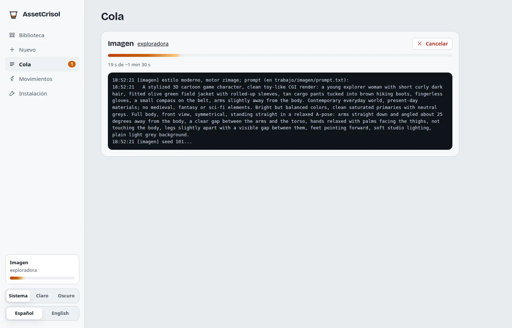

## 2. Ver el resultado

La pestaña **Resultado** del asset tiene una sub-pestaña por cosa generada, con el número del paso que la hizo. Los
ejemplos de acá son de *Cris*, la protagonista de los ejemplos de AssetCrisol.

**Isométrico**: el personaje en 8 direcciones. Elegí la animación arriba y la dirección en la rosa; es lo que se ve
en un juego isométrico.

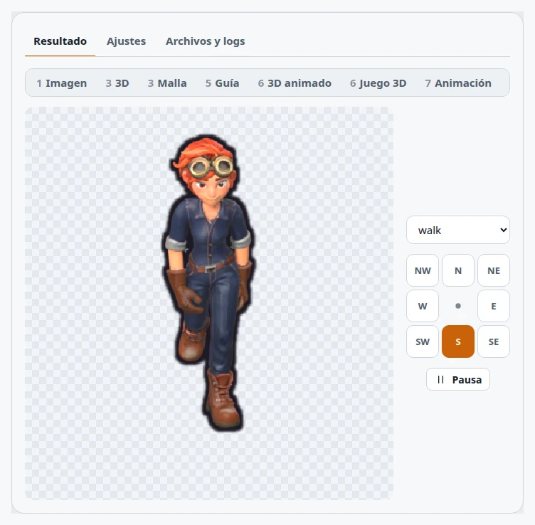

**3D animado**: el modelo con su esqueleto, en la animación que elijas y al ritmo de los sprites. Arrastrá para
girarlo, rueda o dos dedos para acercar, clic derecho (o dos dedos) para mover la cámara y doble clic para enfocar
un punto (la cara, un pie). Sirve para ver un codo o una rodilla desde cualquier lado.

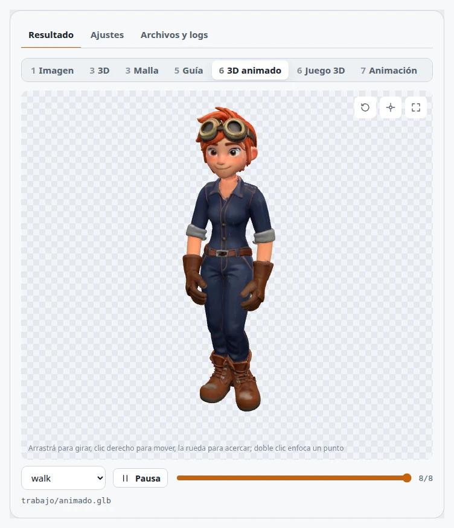

**Animación**: la hoja de costado animada, de a una animación, con pausa y una barra para ir cuadro por cuadro.

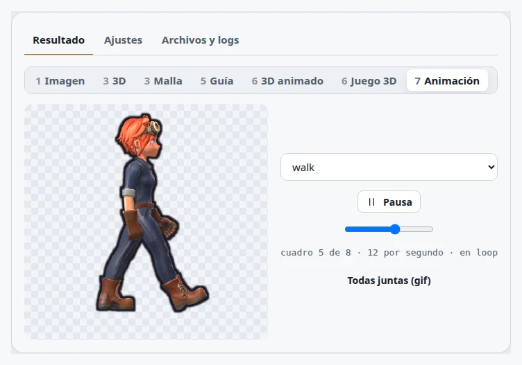

**Retrato**: la cara recortada y el cuerpo de frente, para diálogos o menús.

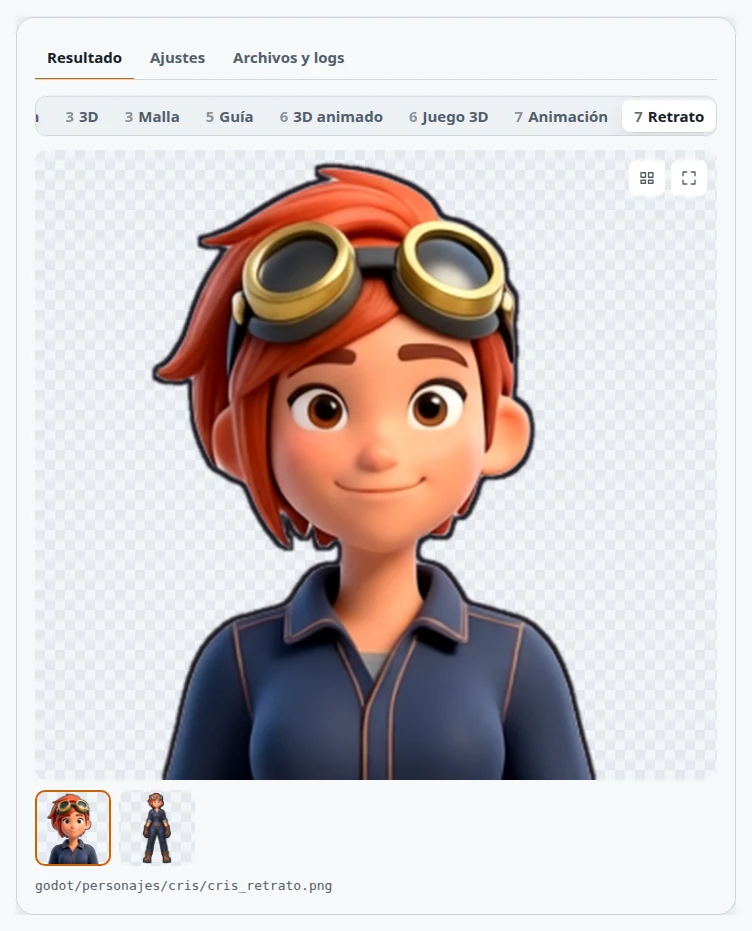

**Juego 3D**: el modelo reducido para un juego 3D, en tres niveles de detalle (LOD), con sus caras y su peso. *Ver las
caras* lo muestra en alambre.

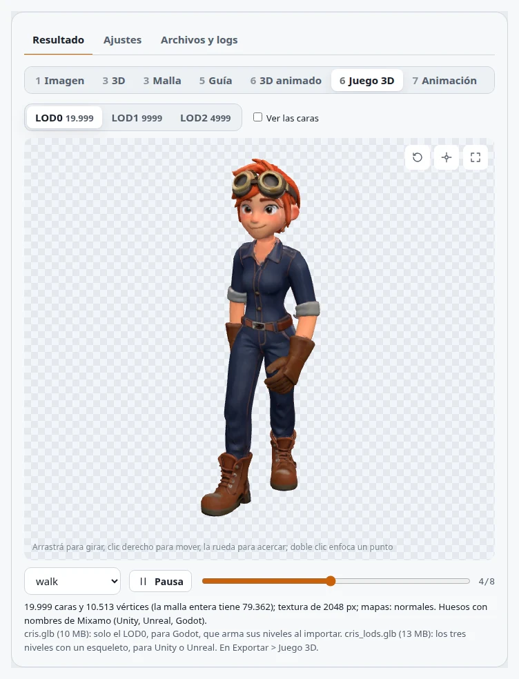

**Revisión**: la hoja de control. La caminata de frente y de espalda, la cabeza de costado, los codos doblados, las
poses clave y, en magenta, lo que se ve del **interior** de la malla (ropa que se atraviesa, agujeros). Avisa si en
alguna pose el interior pasa del 3 %. La **revisión de cerca**, al lado, muestra codos, hombros, rodillas y cara en
las poses que más los doblan.

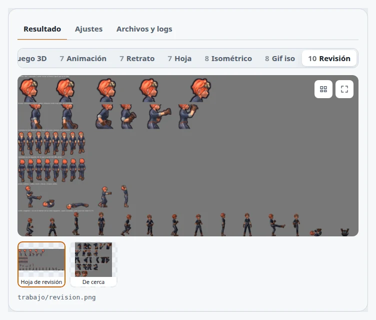

## 3. Cuando algo sale mal

Casi todo se arregla rehaciendo un paso con otro ajuste. Antes de tocar nada, **Más** en el paso dice qué mirar y qué
probar:

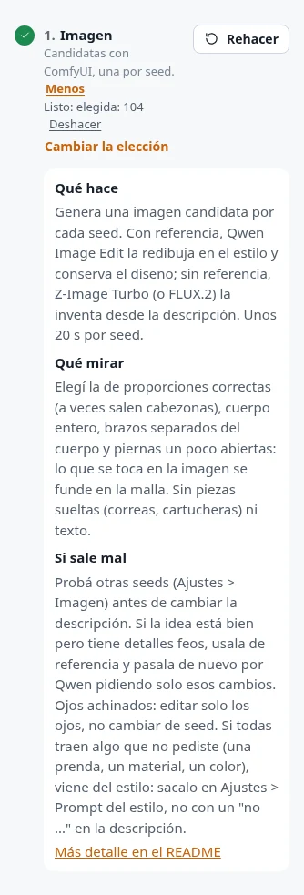

| Qué ves | Dónde | Qué probar |
| --- | --- | --- |
| La imagen tiene algo que no pediste en todas las seeds (una prenda, un material) | Imagen | Viene del estilo: Ajustes > *Prompt del estilo* |
| La espalda copia lo del pecho | Vistas, Malla | Borrar la vista mala y rehacer Vistas; en la malla, *Pintar la espalda con la vista de Qwen* |
| Cara manchada u ojos raros | Malla | Otra *Seed de UltraTex*; con TRELLIS.2, probar Pixal3D + UltraTex |
| Agujeros o piezas que faltan | Malla | Otra seed de malla (como candidato, para comparar) |
| Rodillas que doblan para atrás, brazos que giran raro | Guía | Las articulaciones: revisarlas en la guía y acomodarlas a mano |
| Codos que se aplastan "de plastilina" | Revisión de cerca | README > [Cuando los pesos fallan](../README.md#cuando-los-pesos-fallan) |
| Al levantar el brazo, el pantalón o los dedos se estiran como astillas | Revisión (golpe, lanzar, brazos arriba) | Las manos tocaban los muslos en reposo. *Editar el json completo*: `modelo.pesos_zonas`, cajas que mandan el pantalón al muslo y la mano entera a la mano (README > [Cuando los pesos fallan](../README.md#cuando-los-pesos-fallan)) |
| Manchas magenta grandes en la revisión | Revisión | Ropa que se atraviesa o agujeros: otra malla |
| La cara mira para arriba o para abajo | Isométrico | Ajustes > Modelo > *Cabeza arriba* (negativo levanta la cara) |
| La ropa parece de plástico lustrado | Todo | El estilo `moderno_juguete` es para juguetes: pasar a `moderno` y rehacer desde Rig |
| Se ve chico o grande en el juego | Sprites | Ajustes > Sprites > *Alto en pantalla* |

**Articulaciones.** Si están mal, todo lo que sigue sale mal. La pestaña **Guía** las muestra sobre el modelo, de frente
y de costado: cada punto tiene que caer en su lugar del cuerpo (hombros, codos, muñecas, caderas, rodillas, tobillos).

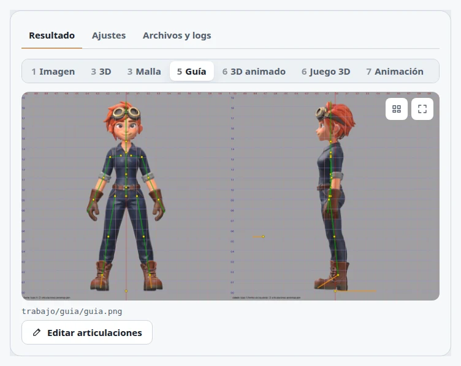

**Editar articulaciones** abre el editor para arrastrarlas (o moverlas con las flechas). De frente, lo de un lado se
copia al otro. Guardar deja Rig y animaciones para rehacer.

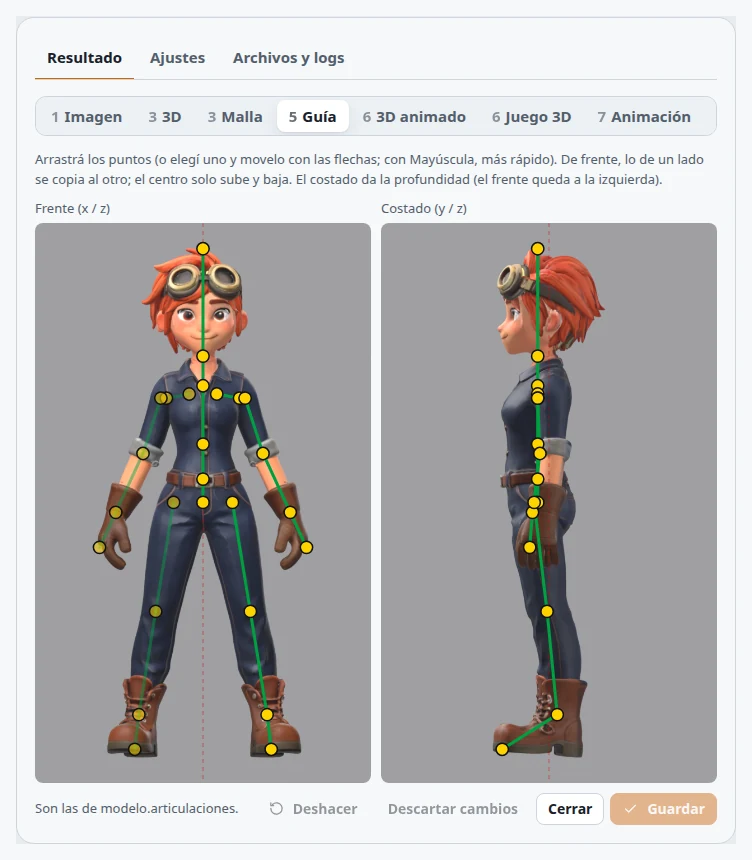

**Deshacer** (en cada paso, junto a su estado) borra lo que generó ese paso. Antes de hacerlo muestra qué archivos va a
borrar y cuánto pesan. No toca tus elecciones ni tus ajustes.

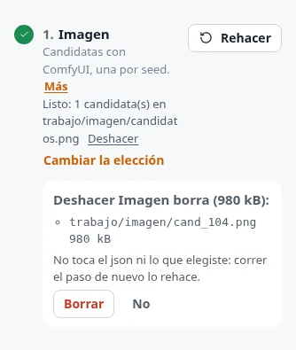

**Desactualizado** no es un error: cambiaste algo de lo que el paso depende (una elección, un ajuste) y hay que
rehacerlo. **Siguiente** va rehaciendo en orden lo que quedó viejo.

## 4. Ajustes

La pestaña **Ajustes** del asset cambia lo común sin tocar archivos. Al guardar, los pasos afectados quedan
desactualizados. Abajo, **Editar el json completo** es el modo avanzado (muestra los cambios antes de guardar);
no hace falta para nada de este manual.

**Estilo**: cómo se ve todo (la imagen y el render). `moderno` y `semirealista` para personas, `moderno_juguete` solo
para juguetes de plástico.

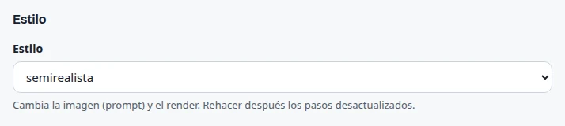

**Prompt del estilo**: las partes del pedido al modelo de imagen que vienen del estilo (técnica, tema, paleta, luz y
fondo), con el pedido completo que sale. Se pueden editar o sacar solo para este asset.

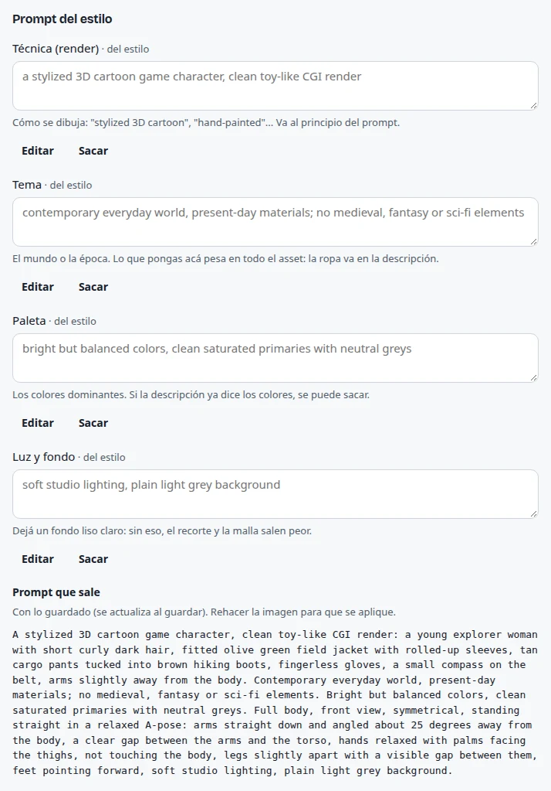

**Imagen**: la descripción y las seeds (una candidata por seed).

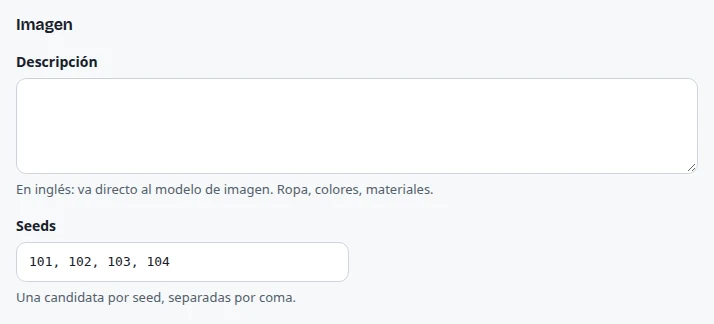

**Malla**: el motor, la seed y la resolución, y los **candidatos** para comparar (cada uno hereda lo que no cambie
del principal). *Generar los que faltan* corre solo los nuevos.

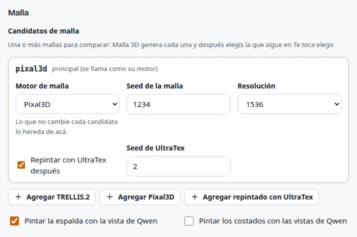

**Modelo**: la altura en metros (la escala de todo) y la inclinación de la cabeza.

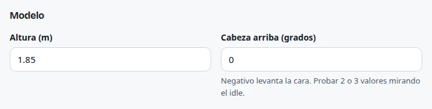

**Sprites**: el alto en pantalla, la baldosa iso y la calidad de cada hoja, con el tamaño que va a tener en el juego, y el zoom del retrato (para cuando alas o una mochila dejan la cabeza chica).

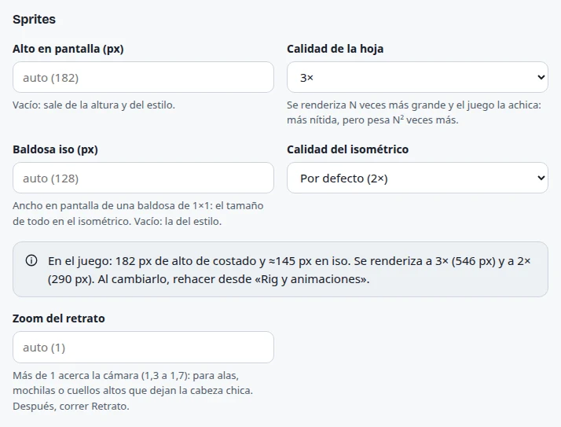

**Animaciones**: cuáles se renderizan en isométrico (menos animaciones, menos peso) y con qué se arma cada una:
*procedural* (poses calculadas) o *kimodo* (un clip de movimiento con IA, ver [6. Movimientos](#6-movimientos-kimodo)).

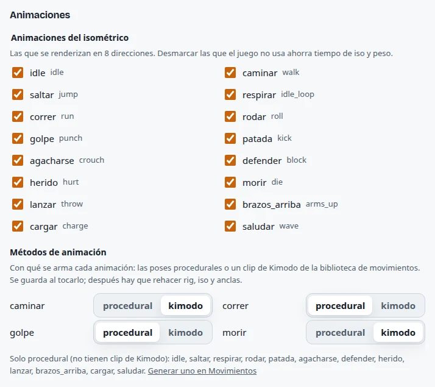

**Juego 3D**: si se exporta el modelo para un juego 3D, la calidad de cada nivel de detalle, la textura, los mapas y
los nombres de los huesos (Mixamo, que reconocen Unity, Unreal y Godot).

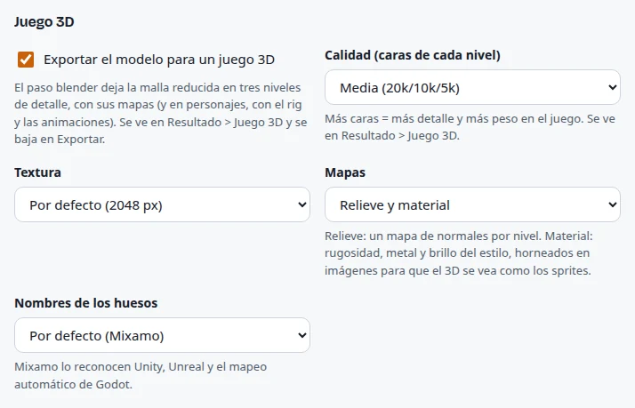

## 5. Otros tipos de asset

Todos siguen la misma idea (crear, correr los pasos, elegir, mirar el resultado). Solo cambia la cadena:

- **Objeto** (una caja, una herramienta, un mueble): imagen, malla, render de vistas y hoja. Sin esqueleto.
  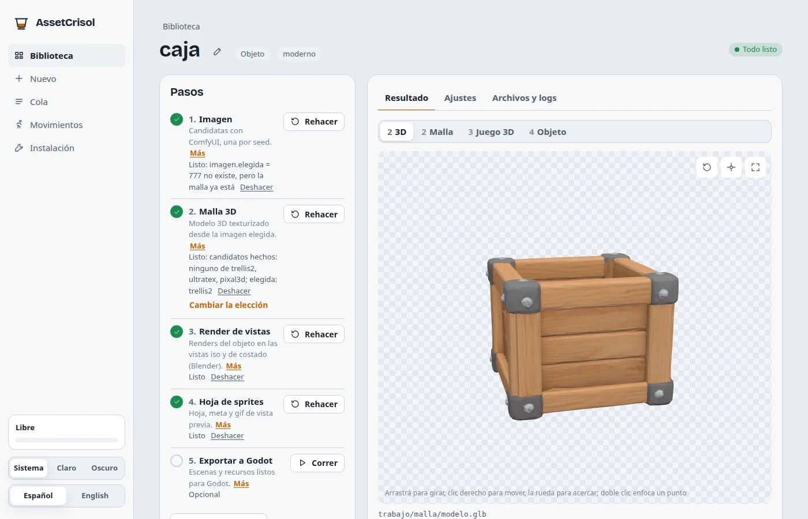
- **Vehículo**: como un objeto, pero separa las ruedas para que giren y arma un modelo con la carrocería y las cuatro
  ruedas. La receta supone un auto.
  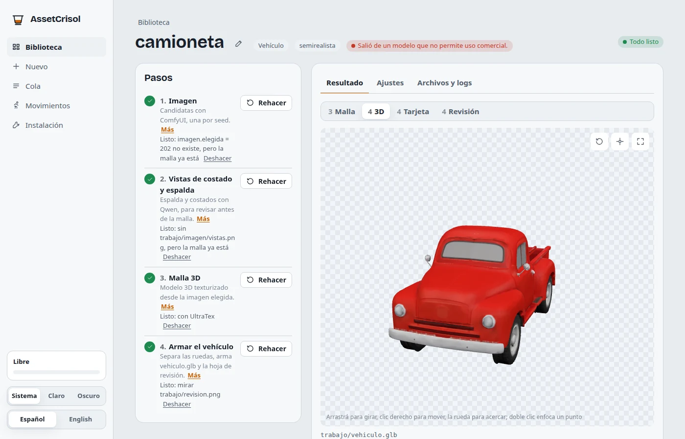
- **Escenario** (piso, camino y pared que se repiten): **Texturas** genera candidatas de cada una, elegís en *Te toca
  elegir* y **Tema del escenario** arma las repetibles y los colores.
  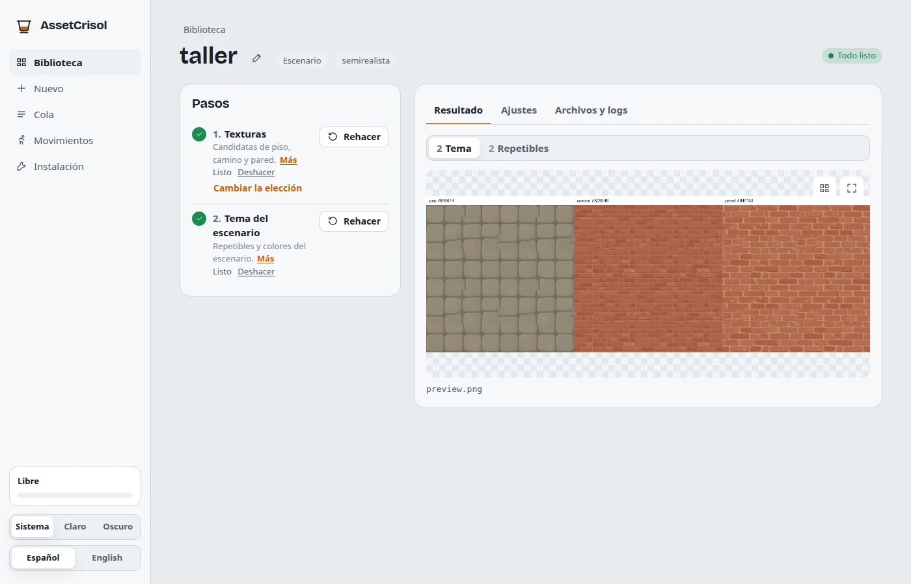
- **Chibi, Robot, Juguete**: personas con otra receta (cabezones, placas rígidas que no se deforman, brillo de
  plástico). La cadena es la de una persona.
- **Cuadrúpedo** (perro, gato, caballo): su propio esqueleto con cuatro patas y cola, y 8 animaciones. Las
  articulaciones se estiman de la malla.
- **Planta**: árboles y arbustos con el follaje en masas, sin hojas sueltas.

## 6. Movimientos (Kimodo)

Las animaciones salen de poses calculadas (*procedural*), salvo las que usan un **clip de Kimodo**: un movimiento
generado con IA desde una frase en inglés ("a person walks forward confidently"). Gana en movimientos de cuerpo
entero (caminar, correr, morir) y pierde en golpes; se elige por animación en Ajustes > Animaciones.

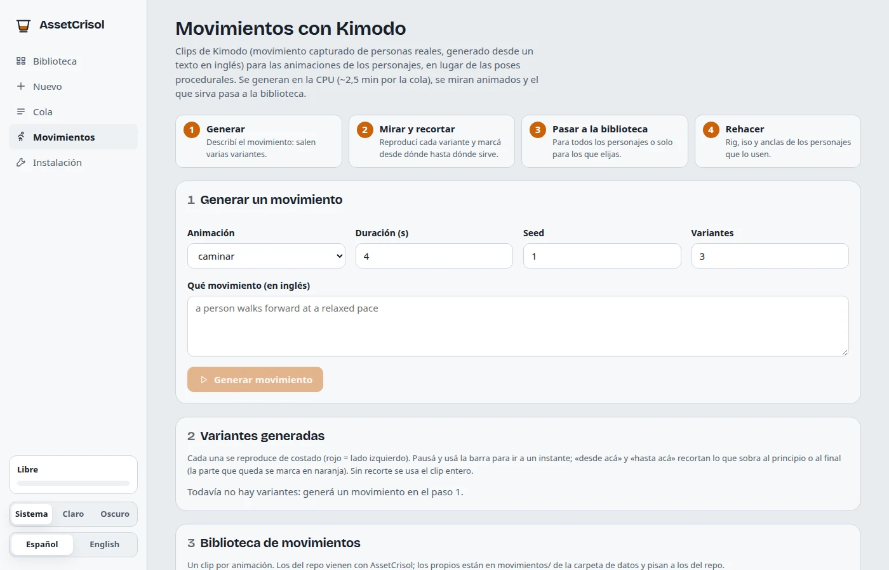

En **Movimientos**:

1. **Generar**: la frase, la duración y cuántas variantes. Corre en el procesador, no en la placa.
2. **Mirar**: cada variante con un esqueleto animado (así se ve un clip de la biblioteca):

   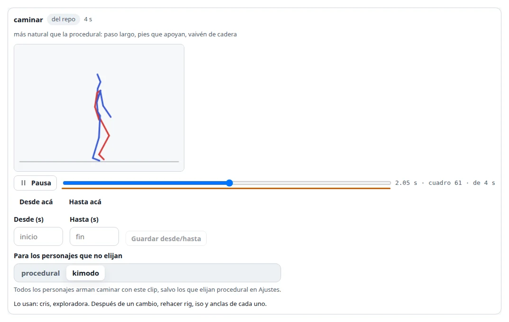

3. **Recortar**: marcá un instante con *Desde acá* y *Hasta acá*. Para caminar o correr, un ciclo: de un apoyo de un pie
   al siguiente apoyo del mismo pie.
4. **Pasar a la biblioteca** como una animación (caminar, correr...). Dice qué personajes la usan; después, en cada
   uno, rehacer Rig, Isométrico y Anclas.

## 7. Llevarlo al juego

**Archivos y logs > Exportar**: marcá qué bajar y **Bajar zip**. También funciona desde el celular o desde otra PC.

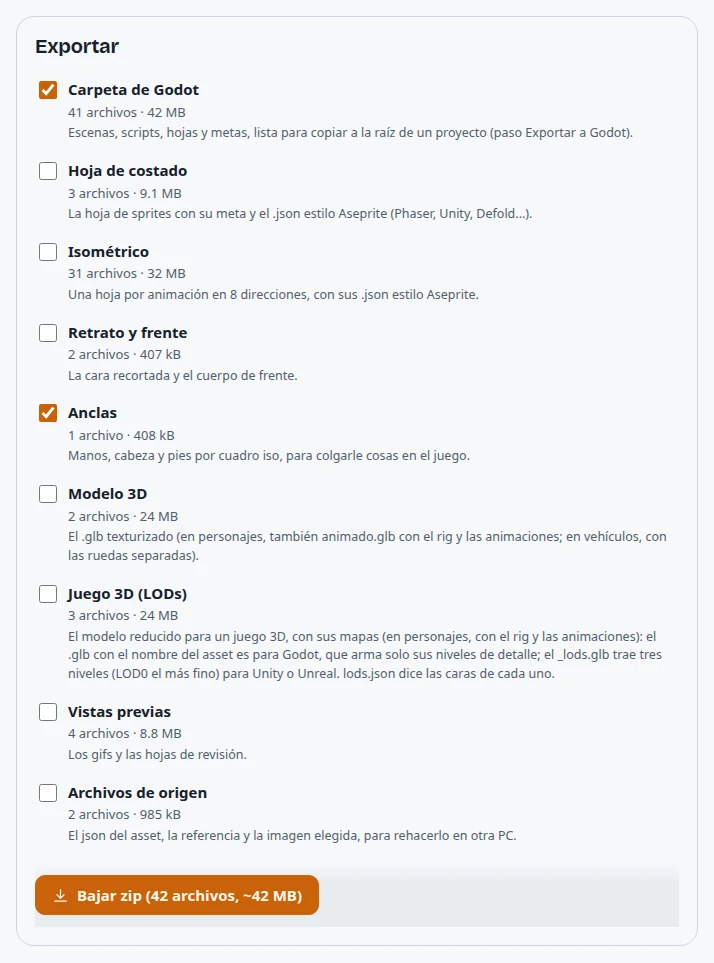

- **Carpeta de Godot**: escenas, scripts, hojas y metas, para copiar a la raíz de un proyecto de Godot. Cómo usarla:
  README > [Guía de Godot](../README.md#guia-de-godot).
- **Hoja de costado** e **Isométrico**: las hojas de sprites con un `.json` estilo Aseprite, que leen Unity, Phaser,
  Defold y la mayoría de los motores 2D.
- **Retrato y frente**, **Anclas** (dónde están las manos y la cabeza en cada cuadro, para colgarle una espada o un
  casco).
- **Modelo 3D** y **Juego 3D (LODs)**: el `.glb` texturizado y el reducido para un juego 3D, con esqueleto y
  animaciones en personajes.
- **Archivos de origen**: el json, la referencia y la imagen elegida, para rehacer el asset en otra PC.

## 8. Cola, biblioteca y trabajo en lote

**Cola**: el paso que corre (con su log en vivo y **Cancelar**), los que esperan y el historial de los terminados,
cada uno con su log. El historial se borra entero o por partes. Si cerrás `crisol ui`, el paso que corre sigue y los
que esperan arrancan al volver a abrirla.

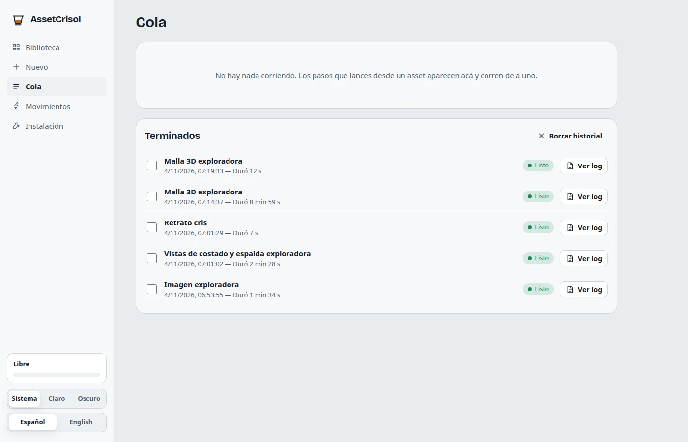

**Biblioteca**: filtros por tipo y búsqueda por nombre. Cada tarjeta muestra la barra de pasos y qué sigue (o si te
toca elegir algo). **Seleccionar** marca varios personajes para rehacerlos en lote (rig, sprites, iso, anclas y
revisión), por ejemplo después de cambiar una animación.

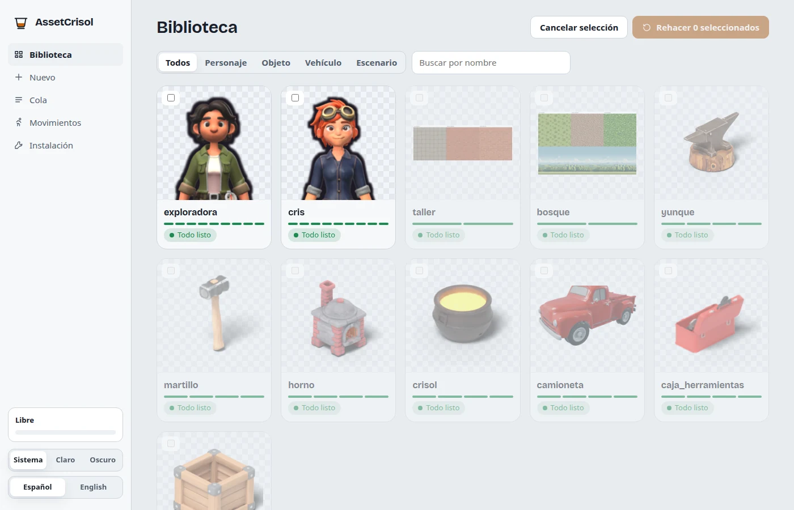

**Cambiar el nombre**: el lápiz junto al nombre del asset. Cambia la carpeta y sus archivos; lo que ya hayas copiado a
un juego sigue con el nombre viejo.

## 9. Licencias en dos minutos

El código de AssetCrisol es libre (GPL-3.0), pero **cada modelo de IA tiene su licencia**, y algunos no permiten uso
comercial de lo que generan. La página de cada asset lo avisa arriba, junto al nombre (*Salió de un modelo que no
permite uso comercial*), y **Archivos y logs > Licencias** dice qué modelos lo hicieron. La receta de *Persona* repinta
la textura con UltraTex (FLUX.2 Klein), que **no es comercial**: para un juego que vas a vender, en Ajustes > Malla
sacá *Repintar con UltraTex después* (queda la textura del motor, más pobre) y rehacé desde la malla.

Detalle por modelo y preguntas frecuentes: [docs/licencias.md](licencias.md). Es una guía, no asesoramiento legal.

---

### Rehacer las capturas

Las imágenes de este manual salen de `tests/capturas_ui.py` (necesita `uv`, que pone Playwright, y `google-chrome`), con la UI corriendo sobre una carpeta de datos aparte
(nunca la de trabajo): los ejemplos con sus pasos hechos y la exploradora del capítulo 1.

```bash
# config de prueba: copia de config.json con "datos_dir" en una carpeta nueva
cp -r ejemplos/* <datos>/
ASSETCRISOL_CONFIG=<config> crisol rehacer cris          # y blender/sprites/iso de cada objeto, tema de cada escenario
ASSETCRISOL_CONFIG=<config> crisol ui --puerto 8191 --no-abrir
python3 tests/capturas_ui.py                             # todas, en es y en; --solo a,b para algunas; --lista
```

Las del capítulo 1 (`--lista` las marca como momentos) muestran a la exploradora en un punto del camino (antes de elegir
la imagen, con la malla corriendo): se sacan con `--solo` cuando llega a ese punto.
